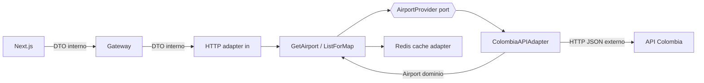

# Adapter pattern (Airport Service)

## Rules

1. **Port** (`AirportProvider`) is defined in domain language.
2. **Adapter** translates external fields → `Airport` (anti-corruption layer).
3. Controllers expose **internal** DTOs (including Plotly-friendly coordinates).
4. Frontend **never** imports or calls API Colombia URLs.

## Why

Satisfies the rubric’s formal Adapter requirement and keeps external churn out of Itinerary BC and the UI.
