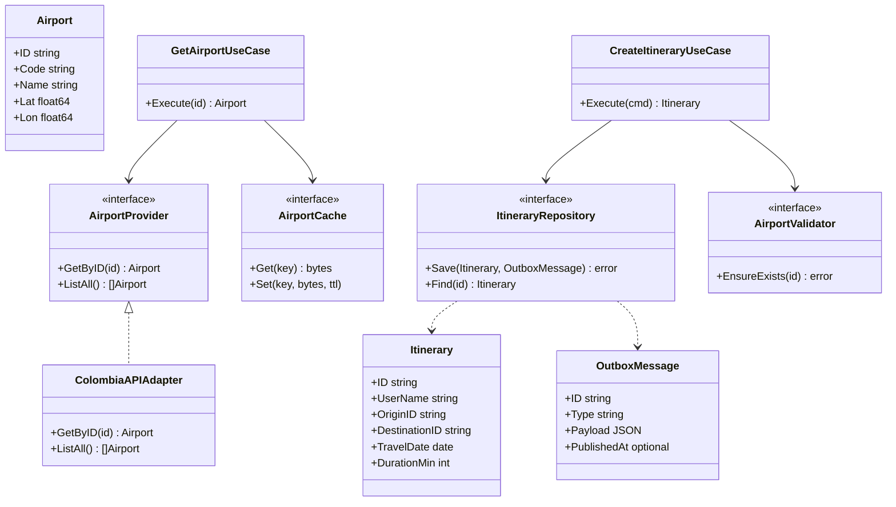

# Class / hexagonal sketch

Conceptual view (not generated from code yet).

## SOLID mapping (short)

- **S:** Use cases and adapters have one reason to change.
- **O:** New providers implement `AirportProvider` without editing itinerary code.
- **L:** Adapters honor port contracts (including error semantics).
- **I:** Narrow ports (`AirportValidator` ≠ full catalog admin API).
- **D:** Application depends on ports, not concrete HTTP/DB types.
