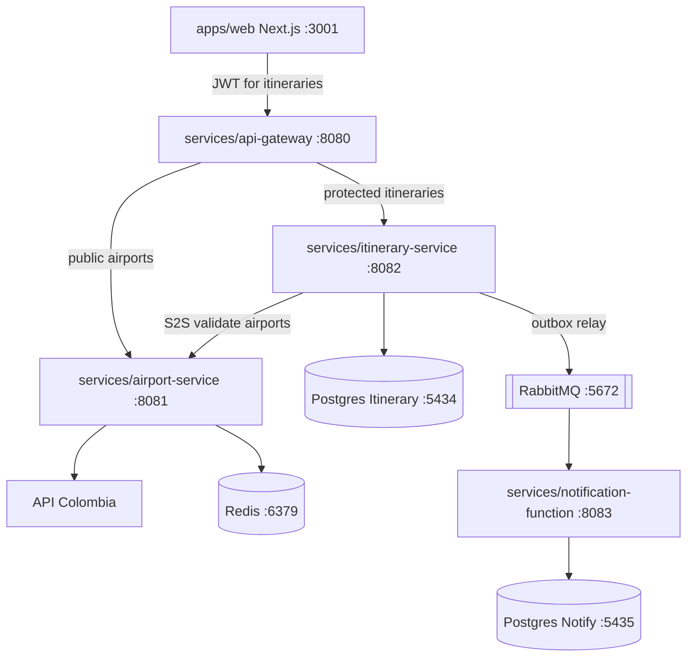

# Component diagram

## Current wiring

- Browser → **API Gateway only** (`:8080`).
- Itinerary routes require Bearer JWT issued via `POST /auth/token`.
- Itinerary → Airport remains direct service-to-service (not through the gateway).
- Airport → Redis cache-aside; circuit breaker wraps Colombia HTTP.
- Itinerary outbox relay → RabbitMQ → notification-function (idempotent).

## Notes

- Each service package is independently buildable/deployable.
- Contracts live in `packages/contracts` and `packages/proto`.
- Local stack: `make up` from repo root.
