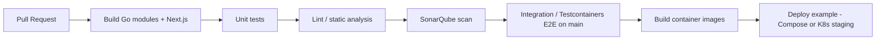

# CI/CD plan

## Why

Level 3 and the DevOps rubric require continuous integration and an example of continuous deployment, plus quality gates (tests, SonarQube).

## Current (this PR)

| Workflow | Trigger | Purpose | Budget |
|----------|---------|---------|--------|
| [`.github/workflows/ci.yml`](../../.github/workflows/ci.yml) | PR + push `main` | **Go unit tests only** (airport, itinerary, gateway, notify, proto) | `timeout-minutes: 3` |

No image publish / Sonar / Deploy yet — keep CI fast until those land in dedicated PRs.

## Target pipeline (later)

## Jobs (planned)

| Workflow | Trigger | Purpose |
|----------|---------|---------|
| `ci.yml` | PR + push `main` | Unit tests (done) |
| `sonar.yml` | PR + main | SonarQube / SonarCloud |
| `e2e.yml` | main / nightly | Testcontainers flow |
| `cd-example.yml` | tags / main | Push images + sample deploy |

## Environments

| Env | Purpose |
|-----|---------|
| Local Compose | Dev + demo |
| CI ephemeral | PR verification |
| Staging K8s (optional) | CD example with probes |

## Secrets

Stored in GitHub Actions secrets — never in git. Document required names when CD lands.
