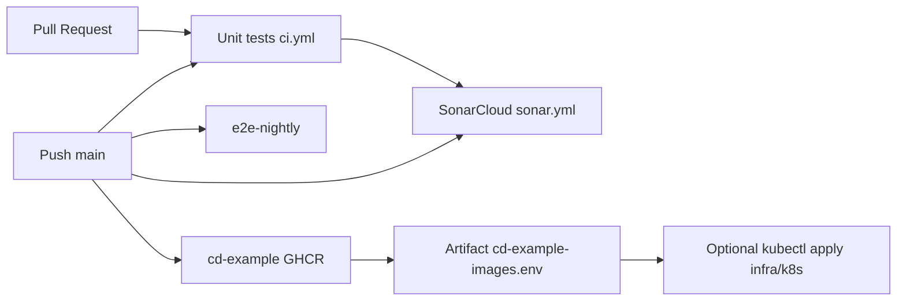

# CI/CD plan

## Why

Level 3 and the DevOps rubric require continuous integration and an example of continuous delivery, plus quality gates (tests, SonarQube/SonarCloud).

## Current

| Workflow | Trigger | Purpose | Budget |
|----------|---------|---------|--------|
| [`.github/workflows/ci.yml`](../../.github/workflows/ci.yml) | PR + push `main` | Go unit tests (airport, itinerary, gateway, notify, proto) | `timeout-minutes: 3` |
| [`.github/workflows/e2e-nightly.yml`](../../.github/workflows/e2e-nightly.yml) | nightly / `main` path / dispatch | Testcontainers Postgres E2E | 10 min |
| [`.github/workflows/sonar.yml`](../../.github/workflows/sonar.yml) | PR + push `main` / dispatch | Coverage + **SonarCloud** quality gate | 15 min |
| [`.github/workflows/cd-example.yml`](../../.github/workflows/cd-example.yml) | push `main` / tags `v*` / dispatch | Build & push images to **GHCR** + image pointer artifact | ~20 min |

## Minimal CD (what it does / does not)

**Does**

- Multi-arch-ready Buildx builds for `airport-service`, `itinerary-service`, `api-gateway`, `notification-function`.
- Pushes to `ghcr.io/<owner>/rutaco-<service>` with `latest` (on `main`), branch, semver, and `sha-<short>` tags.
- Uploads `infra/k8s/cd-example-images.env` as a workflow artifact listing the SHA tags for a local/staging apply.

**Does not**

- Require a live Kubernetes cluster in GitHub Actions (no kubeconfig secret by default).
- Mutate production. Operators apply `infra/k8s/` after `docker login ghcr.io` using the artifact tags.

## SonarCloud setup (one-time)

1. Create a project at [sonarcloud.io](https://sonarcloud.io) for this GitHub repo (org/user key must match `sonar.organization` in `sonar-project.properties`).
2. Generate a token and add GitHub Actions secret **`SONAR_TOKEN`**.
3. Confirm `sonar.projectKey` / `sonar.organization` in `sonar-project.properties` match the SonarCloud UI.
4. Re-run workflow `sonar` (or open a PR). Quality gate waits (`sonar.qualitygate.wait=true`).

## Secrets

| Name | Used by | Notes |
|------|---------|-------|
| `SONAR_TOKEN` | `sonar.yml` | Required for SonarCloud scan |
| `GITHUB_TOKEN` | `cd-example.yml` | Built-in; needs `packages: write` (set on the workflow) |

Never commit tokens. Package visibility for GHCR may need a first manual “public” toggle under GitHub Packages if reviewers pull without auth.

## Environments

| Env | Purpose |
|-----|---------|
| Local Compose | Dev + demo (`make up`) |
| CI ephemeral | PR verification |
| GHCR + K8s manifests | CD example with probes (`infra/k8s/`) |
