<style>
  @page { margin: 22mm 18mm; }
  body {
    font-family: "Helvetica Neue", Helvetica, Arial, sans-serif;
    font-size: 11pt;
    line-height: 1.45;
    color: #1e293b;
  }
  h1 { font-size: 20pt; color: #0f172a; border-bottom: 3px solid #059669; padding-bottom: 8px; page-break-before: always; }
  h1:first-of-type { page-break-before: avoid; }
  h2 { font-size: 15pt; color: #0f172a; margin-top: 1.6em; border-bottom: 1px solid #cbd5e1; padding-bottom: 4px; }
  h3 { font-size: 12.5pt; color: #134e4a; margin-top: 1.2em; }
  h4 { font-size: 11.5pt; color: #334155; }
  table { width: 100%; border-collapse: collapse; margin: 12px 0 18px; font-size: 9.5pt; }
  th, td { border: 1px solid #cbd5e1; padding: 6px 8px; vertical-align: top; }
  th { background: #ecfdf5; color: #064e3b; text-align: left; }
  img { max-width: 100%; height: auto; display: block; margin: 12px auto; border: 1px solid #e2e8f0; }
  .cover { text-align: center; margin-top: 18%; }
  .cover h1 { border: none; font-size: 26pt; page-break-before: avoid; }
  .muted { color: #64748b; }
  .caption { text-align: center; font-size: 9pt; color: #64748b; margin-top: -6px; margin-bottom: 18px; }
  code { font-size: 9.5pt; background: #f1f5f9; padding: 1px 4px; border-radius: 3px; }
  ul, ol { margin-top: 6px; }
  .toc a { color: #0f172a; text-decoration: none; }
</style>

<div class="cover">

# FORMATO ARQUITECTURA DE SOFTWARE

## RutaCO — Personal Itineraries Platform

**Plataforma de itinerarios personales de viaje**  
*(aeropuertos colombianos + microservicios + eventos + serverless)*

**Autor:** Camilo Plaza  
**Repositorio:** `proyecto-arquitectura-software-emergente`  
**Versión del documento:** 1.0.0  
**Fecha:** 2026-11-18  
**Estado:** Niveles 1 + 2 + 3 implementados (evidencia en autoevaluación)

<p class="muted">Documento alineado a la estructura de “Formato Arquitectura de Software” (vistas, RNF, tácticas, DevOps y amenazas), con contenido y diagramas propios del sistema RutaCO.</p>

</div>

---

## Versionamiento de la arquitectura de software

| Fecha | Versión | Autor | Descripción del cambio |
|-------|---------|-------|------------------------|
| 2026-10-19 | 0.1.0 | Equipo / Camilo Plaza | Borrador inicial alineado al reto (Niveles 1–3) |
| 2026-11-18 | 1.0.0 | Camilo Plaza | Documento de entrega: estructura formal + vistas + diagramas actualizados (Leaflet Studio, Outbox, Gateway, K8s, CI/CD) |

---

## Tabla de contenido

1. Abreviaturas y definiciones  
2. Introducción  
3. Alcance  
4. Interesados  
5. Requerimientos no funcionales  
6. Priorización de atributos de calidad  
7. Tácticas de arquitectura  
8. Verificación de tácticas de arquitectura  
9. Lineamientos técnicos de la arquitectura  
10. Vistas de arquitectura  
    - 10.1 Vista lógica  
    - 10.2 Vista de implementación  
    - 10.3 Vista de integración  
    - 10.4 Vista de despliegue  
    - 10.5 Procesos DevOps  
    - 10.6 Vista de amenazas  

---

# 1. Abreviaturas y definiciones

| Término | Definición |
|---------|------------|
| **API** | Interfaz de programación de aplicaciones |
| **REST** | Estilo de intercambio de recursos sobre HTTP |
| **JWT** | JSON Web Token para autenticación / autorización en el borde |
| **BFF / Gateway** | Punto único de entrada; enrutamiento, rate limit y propagación JWT **sin** lógica de negocio |
| **Puerto / Adapter** | Contrato de dominio (port) vs adaptador de infraestructura (hexagonal / Ports & Adapters) |
| **Outbox** | Tabla transaccional para publicación confiable de eventos (Transactional Outbox) |
| **FaaS** | Function as a Service — ejecución efímera de notificaciones / reportes |
| **OTel** | OpenTelemetry — trazas y métricas distribuídas |
| **DDD** | Domain-Driven Design |
| **BC** | Bounded Context (contexto delimitado) |
| **AsyncAPI** | Especificación de contratos asíncronos (eventos) |
| **OpenAPI / Swagger** | Contratos REST versionados |
| **gRPC** | RPC sobre HTTP/2 con Protobuf (validación S2S Airport ↔ Itinerary) |
| **ACL** | Anti-Corruption Layer — aísla el esquema externo de API Colombia |
| **RutaCO** | Marca de producto de la plataforma de itinerarios personales |
| **CB** | Circuit Breaker |
| **mTLS** | Mutual TLS entre servicios (Nivel 3) |
| **CI/CD** | Integración y despliegue continuos (GitHub Actions + GHCR) |

---

# 2. Introducción

El presente documento tiene como objetivo principal **definir la arquitectura de software para la construcción de RutaCO (Personal Itineraries Platform)**, permitiendo identificar los requisitos funcionales y técnicos, trazar el alcance de la solución y comunicar a los interesados cómo se cumplen los atributos de calidad.

RutaCO combina **tres estilos arquitectónicos** en un monorepo ejecutable:

1. **Microservicios** — `airport-service` e `itinerary-service` (hexagonal por servicio, una BD por servicio).  
2. **Event-driven** — evento de integración `ItineraryCreated` vía RabbitMQ + **Transactional Outbox**.  
3. **Serverless** — `notification-function` consumiendo eventos (simulación FaaS local / LocalStack–OpenFaaS).

El frontend (**Next.js 15 App Router**) ofrece Studio con mapa Leaflet (adaptadores de tiles), wizard de viajes, packing checklist y preferencias de perfil. El borde es un **API Gateway Go** (JWT + rate limit). La observabilidad usa OpenTelemetry + Jaeger y Prometheus + Grafana.

Este documento estructura la arquitectura mediante **vistas** (lógica, implementación, integración, despliegue, DevOps y amenazas) y enlaza las **tácticas** con los RNF priorizados.

---

# 3. Alcance

## Incluye

| Área | Descripción |
|------|-------------|
| Catálogo de aeropuertos | Consumo de API Colombia vía **Adapter** + Redis cache + resiliencia (timeout, retry, CB, bulkhead) |
| Mapa / Studio | Next.js + React-Leaflet; tiles vía port `MapTileProvider` (CARTO/OSM/OpenTopo/Esri); click origen→destino |
| Itinerarios | CRUD, planes opcionales, packing; validación de aeropuertos HTTP/gRPC |
| Notificación asíncrona | `ItineraryCreated` → FaaS + historial en BD propia |
| Edge | API Gateway: rutas, JWT, rate limit; **sin** reglas de negocio |
| Persistencia | PostgreSQL **una BD por servicio**; migraciones versionadas; Outbox en Itinerary |
| Observabilidad | Logs JSON + `trace_id`; OTel/Jaeger; métricas/alertas Prometheus |
| Orquestación | Docker Compose (local); Kubernetes + probes (Nivel 3) |
| Calidad / entrega | OpenAPI, AsyncAPI, Pact, SonarCloud, GHCR CD example, wiki + ADRs |

## Excluye (YAGNI)

- Booking real con aerolíneas / precios de vuelos  
- App móvil nativa  
- Multi-región activo-activo  
- Proveedor de correo productivo (se simula + persiste historial)  
- Base de datos compartida entre servicios  
- Llamadas a `api-colombia.com` desde el navegador  

---

# 4. Interesados

| Interesado | Necesidad de información | Vistas útiles |
|------------|--------------------------|---------------|
| Arquitecto / docente | Decisiones, tácticas, evidencia de patrones (Adapter, Outbox, hexagonal) | Lógica, integración, ADRs, verificación de tácticas |
| Desarrollador | Contratos OpenAPI/AsyncAPI/gRPC, capas hexagonales, flujo Git | Implementación, secuencias, clases |
| QA / revisor del curso | Criterios de aceptación, demos, autoevaluación Niveles 1–3 | Despliegue, DevOps, amenazas, runbooks |
| Operador / SRE | Logs, trazas, alertas, probes, chaos | Despliegue, CI/CD, amenazas |
| Viajero (usuario final) | UX confiable (mapa, viajes, notificaciones) | No consume este documento; consume la UI RutaCO |

---

# 5. Requerimientos no funcionales

Los RNF describen atributos de calidad distintos a las operaciones funcionales. Se identifican con prefijo **RNF**. Las métricas concretas se validan en escenarios de calidad (sección 8) y en demos (`make smoke`, `make demo-evidence`).

## 5.1 Seguridad

| ID | Nombre | Descripción |
|----|--------|-------------|
| RNF-S1 | Autenticación JWT | Actores autenticados vía `POST /auth/token`; Gateway valida y propaga Bearer + headers `X-User-*` |
| RNF-S2 | Autorización en borde | Rutas de itinerarios protegidas; sin token válido → 401 |
| RNF-S3 | Transferencia segura | HTTPS en entornos desplegados; mTLS S2S en gRPC (Nivel 3) |
| RNF-S4 | Código seguro | Controles alineados a OWASP Top 10; SonarCloud en CI |
| RNF-S5 | Integridad | Persistencia transaccional itinerario + outbox; consumidores idempotentes |
| RNF-S6 | Auditoría mínima | Logs estructurados de acciones relevantes, fallos y correlación `trace_id` / `span_id` |

## 5.2 Interoperabilidad

| ID | Nombre | Descripción |
|----|--------|-------------|
| RNF-I1 | API Colombia | Intercambio HTTP; mapeo vía Adapter al modelo interno (ACL) |
| RNF-I2 | REST interno | Contratos OpenAPI versionados (`/api/v1`, header `API-Version`) |
| RNF-I3 | Eventos | Contratos AsyncAPI; exchange/cola de itinerarios; evento `ItineraryCreated` |
| RNF-I4 | gRPC (L3) | Itinerary ↔ Airport `EnsureExists` con Protobuf + mTLS |
| RNF-I5 | Contratos Pact | Contract testing Airport–Itinerary |

## 5.3 Fiabilidad

| ID | Nombre | Descripción |
|----|--------|-------------|
| RNF-F1 | Tolerancia a fallos | Timeout, retry + backoff + jitter, circuit breaker y bulkhead ante API externa |
| RNF-F2 | Publicación confiable | Outbox transaccional (sin double-write inseguro) |
| RNF-F3 | Recuperación | Migraciones versionadas; datos por servicio aislados; historial de notificaciones |
| RNF-F4 | Disponibilidad demo | Stack local reproducible con Compose; probes readiness/liveness en K8s |
| RNF-F5 | Escalabilidad horizontal | Servicios contenedorizados; Deployments K8s independientes |

## 5.4 Eficiencia en desempeño

| ID | Nombre | Descripción |
|----|--------|-------------|
| RNF-E1 | Cache | Redis cache-aside en Airport Service para catálogo/map payloads |
| RNF-E2 | Runtime eficiente | Go por bajo consumo de CPU/memoria bajo concurrencia |
| RNF-E3 | Latencia edge | Rate limiting en Gateway sin bloquear rutas sanas indebidamente |
| RNF-E4 | Paginación | Listados de itinerarios con `page` / `pageSize` |

**Criterio orientativo (académico):** cargas de mapa preferentemente desde cache; creación de itinerario con validación de aeropuertos y commit Outbox en una transacción; trazas E2E visibles en Jaeger.

## 5.5 Arquitectura

| ID | Nombre | Descripción |
|----|--------|-------------|
| RNF-A1 | Hexagonal | Dominio / aplicación / adaptadores en cada servicio Go; dominio sin imports de infra |
| RNF-A2 | Microservicios | Deploy y BD independientes; sin esquema compartido |
| RNF-A3 | Eventos + FaaS | Notificaciones desacopladas del CRUD |
| RNF-A4 | Gateway sin negocio | Solo routing, auth propagation, rate limit |
| RNF-A5 | Adapter de tiles (FE) | Port `MapTileProvider`; proveedores libres; fallback OSM |

## 5.6 Mantenibilidad

| ID | Nombre | Descripción |
|----|--------|-------------|
| RNF-M1 | Modularidad | Cambios de Adapter Colombia no alteran reglas de itinerario ni UI |
| RNF-M2 | Documentación viva | Wiki + OpenAPI + AsyncAPI + ADRs en el mismo monorepo |
| RNF-M3 | Testabilidad | Puertos mockeables; E2E Testcontainers; Pact |
| RNF-M4 | Reusabilidad | Contratos en `packages/contracts` y `packages/proto` |

## 5.7 Gestión de información

| ID | Nombre | Descripción |
|----|--------|-------------|
| RNF-G1 | Aislamiento de datos | Una BD PostgreSQL por servicio (Airport / Itinerary+Outbox / Notifications) |
| RNF-G2 | Histórico de notificaciones | Persistencia de intentos/resultados en Notification BC |
| RNF-G3 | Eventos durables | Outbox almacena payload hasta publicación confirmada |

## 5.8 Puesta en producción

| ID | Nombre | Descripción |
|----|--------|-------------|
| RNF-P1 | Contenedores | Imágenes por servicio; Compose para demo local |
| RNF-P2 | Kubernetes | Manifests con probes `/ready` y `/live` |
| RNF-P3 | Config / secretos | `CONFIG_FILE` + overlay Vault opcional; secretos solo en CI/env |

## 5.9 DevOps

| ID | Nombre | Descripción |
|----|--------|-------------|
| RNF-D1 | Integración continua | Build + unit tests (≤3 min) + SonarCloud + E2E nightly |
| RNF-D2 | Despliegue continuo (ejemplo) | Build/push GHCR + artifact de tags para `infra/k8s` |
| RNF-D3 | Git flow académico | Ramas estándar + **PR obligatorio** a `main`; Conventional Commits |

---

# 6. Priorización de atributos de calidad

Cada RNF se califica con dos parámetros: **(Importancia, Riesgo/dificultad)** donde H = High, M = Medium, L = Low.

| Atributo de calidad | ID | Requerimiento | Prioridad |
|---------------------|----|---------------|-----------|
| Arquitectura / modularidad | RNF-A1 | Hexagonal por servicio | (H, M) |
| Fiabilidad externa | RNF-F1 | CB + retry + bulkhead | (H, H) |
| Publicación confiable | RNF-F2 | Transactional Outbox | (H, H) |
| Observabilidad | RNF-S6 | OTel + logs + métricas | (H, M) |
| Seguridad JWT | RNF-S1 / S2 | Auth en Gateway | (H, M) |
| Interoperabilidad externa | RNF-I1 | Adapter API Colombia | (H, M) |
| Performance cache | RNF-E1 | Redis | (M, M) |
| Eventos + FaaS | RNF-A3 / I3 | Async notify | (H, M) |
| gRPC / mTLS | RNF-I4 / S3 | S2S Nivel 3 | (M, H) |
| Deploy K8s / CD | RNF-P2 / D2 | Probes + GHCR | (M, H) |
| Código seguro | RNF-S4 | SonarCloud | (H, M) |

El desempate entre atributos de igual importancia se resolvió por juicio de experto a favor de **modularidad hexagonal**, **fiabilidad del borde externo** y **Outbox**, por ser el núcleo de evidencia del reto académico.

---

# 7. Tácticas de arquitectura

| ID / RNF | Táctica | Patrón | Descripción | Tecnología |
|----------|---------|--------|-------------|------------|
| RNF-A1 | Separar responsabilidades | Hexagonal / Ports & Adapters | Dominio puro; adapters in/out | Go modules por capa |
| RNF-I1 | Traducir modelos externos | Adapter / ACL | Schema Colombia → `Airport` interno | Cliente HTTP + adapter |
| RNF-F1 | Detectar fallos / limitar daño | Circuit Breaker + Retry + Bulkhead | Fail-fast, reintentos con jitter, límite de concurrencia | `adapters/out/resilience` |
| RNF-E1 | Cachear | Cache-aside | Evitar fan-out repetido a API externa | Redis |
| RNF-F2 | Evitar double-write inseguro | Transactional Outbox | Misma TX: itinerario + mensaje outbox | Postgres + relay |
| RNF-S1 | Autenticar en borde | API Gateway / BFF | Validar JWT; propagar claims | Gateway Go |
| RNF-A4 | Evitar lógica en edge | Gateway sin negocio | Solo routing / límites / auth | Gateway Go |
| Observabilidad | Correlacionar | Tracing distribuido | Un `trace_id` E2E | OTel + Jaeger |
| RNF-I3 / A3 | Desacoplar side-effects | Event-driven + FaaS | Notificar sin bloquear CRUD | RabbitMQ + notification-function |
| RNF-I4 | RPC tipado S2S | gRPC + mTLS | `EnsureExists` | Protobuf + certs |
| RNF-D1/D2 | Automatizar verificación | Pipeline CI/CD | Tests, calidad, imágenes | GitHub Actions + GHCR |
| RNF-A5 | Intercambiar basemaps | Port + adapters | Tiles sin acoplar UI a un vendor | Leaflet + adapters |

---

# 8. Verificación de tácticas de arquitectura

| RNF | Táctica | Escenario | Criterio de aceptación |
|-----|---------|-----------|------------------------|
| RNF-I1 | Adapter | FE pide aeropuertos para mapa | FE solo ve DTO interno; cero URLs/schema de API Colombia en el browser |
| RNF-F1 | CB / retry | API Colombia caída o lenta | CB open observable; fallback/fail-fast; métricas Prometheus |
| RNF-F2 | Outbox | Create itinerary con broker caído temporalmente | Evento queda en outbox y se publica al recuperar; no se pierde el commit |
| RNF-S1 | JWT | Request a `/itineraries` sin token | 401; con token válido → 2xx y claims propagados |
| OTel | Traza E2E | Flujo create | Un `trace_id` une Gateway → Itinerary → Airport → (async) notify |
| RNF-A1 | Hexagonal | Cambio de proveedor externo | Solo adapter out cambia; dominio/itinerary intactos |
| RNF-I4 | gRPC | Validar aeropuerto | `EnsureExists` preferido si `AIRPORT_GRPC_ADDR` está configurado |
| RNF-D1 | CI | Pull Request | `ci.yml` verde en ≤3 min; Sonar quality gate cuando hay `SONAR_TOKEN` |

---

# 9. Lineamientos técnicos de la arquitectura

## 9.1 Componentes

| Componente | Responsabilidad | No debe |
|------------|-----------------|---------|
| `apps/web` (RutaCO) | UI Studio Leaflet, wizard `/trips`, packing, SEO, preferencias de mapa | Llamar API Colombia; contener reglas de persistencia |
| `services/api-gateway` | Ruteo, rate limit, emisión/validación JWT, propagación | Reglas de itinerario o catálogo |
| `services/airport-service` | Catálogo + Adapter + Redis + resiliencia + gRPC EnsureExists | Persistir itinerarios |
| `services/itinerary-service` | CRUD + planes/packing + Outbox + validación de aeropuertos | Conocer schema API Colombia |
| `services/notification-function` | Consumir eventos; notificar; historial | Exponer CRUD de itinerarios |
| Outbox relay | Publicar mensajes unpublished → RabbitMQ | Lógica de negocio de itinerario |
| RabbitMQ | Transporte de eventos | Lógica de negocio |
| Redis | Cache / coordinación corta | Fuente de verdad de itinerarios |
| Postgres (×3) | Persistencia por BC | Esquemas compartidos cross-service |
| Jaeger / Prometheus / Grafana | Observabilidad | Decidir reglas de dominio |

### Regla de dependencia hexagonal (cada servicio Go)

```text
cmd/                  # main, wiring
internal/domain/      # entities, ports, domain errors
internal/application/ # use cases
internal/adapters/in/ # http | grpc
internal/adapters/out/# postgres | redis | http | messaging
```

Los adaptadores dependen hacia adentro; el dominio no importa infraestructura.

---

# 10. Vistas de arquitectura

## 10.1 Vista lógica

La vista lógica organiza el sistema en **bounded contexts** y servicios de negocio, independientes de nodos físicos.

### 10.1.1 Blueprint de servicios de negocio / contextos

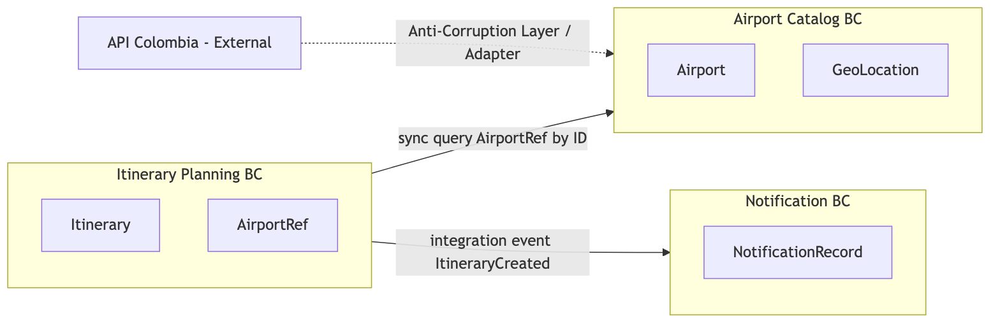
<p class="caption">Ilustración 1. Blueprint de Bounded Contexts (Airport Catalog, Itinerary Planning, Notification) y Anti-Corruption Layer frente a API Colombia.</p>

### 10.1.2 Servicios de negocio

| Servicio / BC | Propósito | Lenguaje ubicuo (extracto) |
|---------------|-----------|----------------------------|
| **Airport Catalog** | Representación confiable de aeropuertos CO para mapa y validación | Airport, AirportProvider, CatalogCache, GeoLocation |
| **Itinerary Planning** | Crear/gestionar itinerarios personales origen–destino | Itinerary, AirportRef, ItineraryCreated, OutboxMessage |
| **Notification** | Reaccionar a eventos de integración; historial de entrega | NotificationRecord, canal, status |

**Invariantes de Itinerary:** origen y destino deben existir en el catálogo al escribir; `duration_minutes > 0`; fecha de viaje requerida.

### 10.1.3 Relaciones de los servicios de negocio

| Relación | Emisor | Receptor | Estilo |
|----------|--------|----------|--------|
| Consulta / validación de aeropuerto | Itinerary BC | Airport BC | Sync REST o gRPC |
| Evento de integración | Itinerary BC | Notification BC | Async (Outbox → RabbitMQ) |
| Adaptación de datos externos | API Colombia | Airport BC | HTTP + Adapter (ACL) |

### Vista de contexto de alto nivel

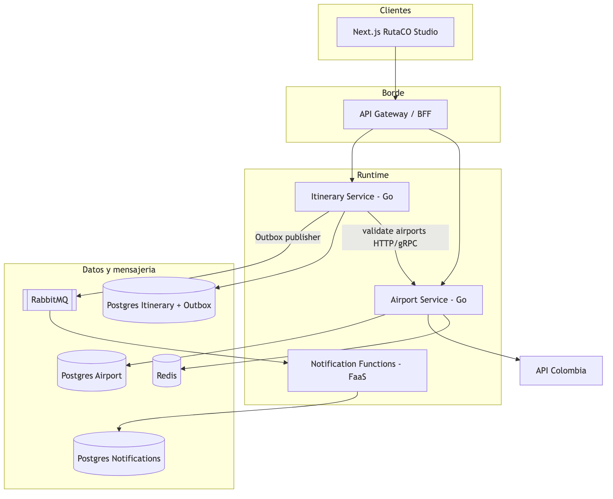
<p class="caption">Ilustración 2. Vista de contexto: clientes → Gateway → servicios → datos/mensajería → API Colombia.</p>

---

## 10.2 Vista de implementación

Describe artefactos desplegables, capas y colaboraciones para transacciones clave.

### 10.2.1 Diagrama de componentes de alto nivel

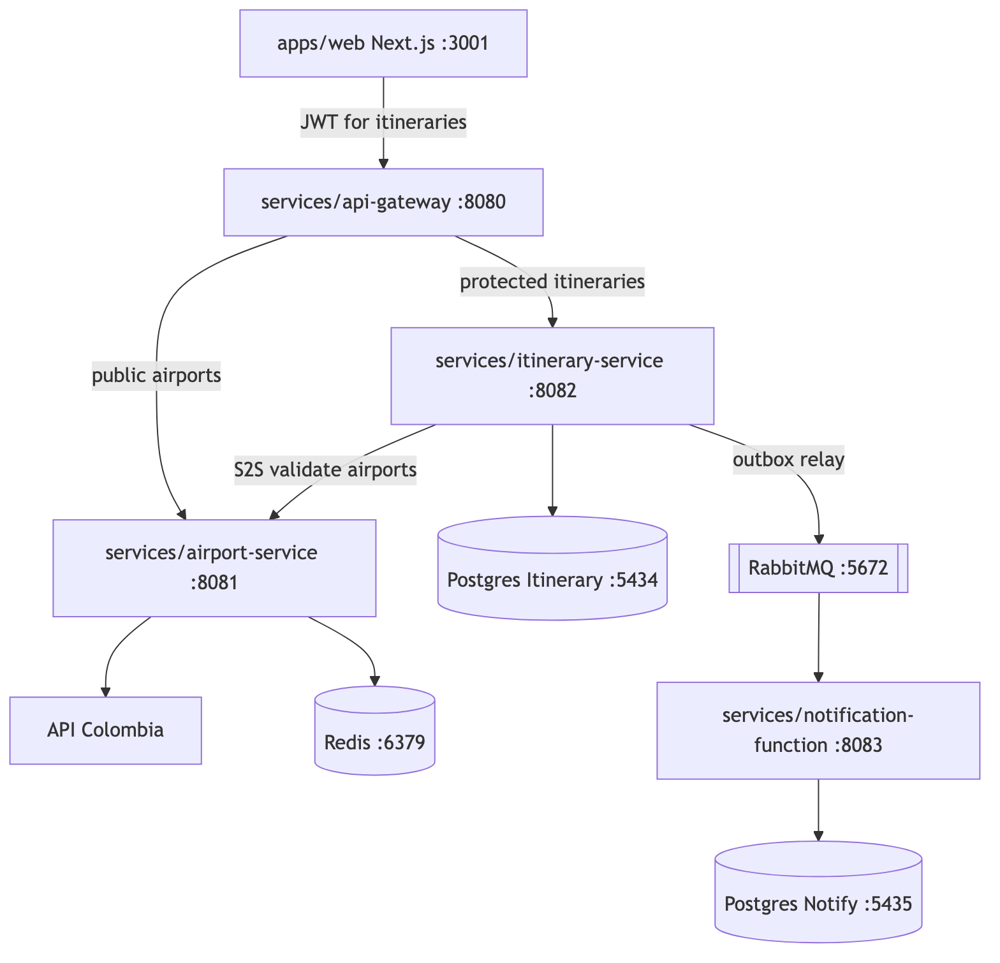
<p class="caption">Ilustración 3. Componentes de alto nivel y puertos locales (Compose).</p>

#### Componentes

| Componente | Descripción |
|------------|-------------|
| Next.js RutaCO | SPA/SSR App Router; Studio, trips, profile |
| API Gateway | Único entry HTTP para el browser |
| Airport Service | Catálogo + resiliencia + cache |
| Itinerary Service | CRUD + Outbox |
| Notification Function | Consumer FaaS |
| Redis / RabbitMQ / Postgres | Infra de soporte por responsabilidad |

#### Relaciones

| Nombre | Emisor | Receptor | Descripción |
|--------|--------|----------|-------------|
| JWT itineraries | Web | Gateway → Itinerary | Rutas protegidas con Bearer |
| Public airports | Web | Gateway → Airport | Catálogo/mapa sin secretos de Colombia en FE |
| S2S validate | Itinerary | Airport | HTTP o gRPC EnsureExists (no pasa por Gateway) |
| Outbox publish | Relay | RabbitMQ → Notify | Evento `ItineraryCreated` |

### 10.2.2 Diagrama de componentes de nivel detallado (hexagonal + Adapter)

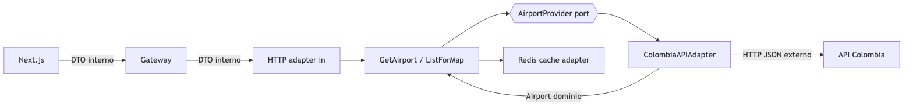
<p class="caption">Ilustración 4. Detalle Ports & Adapters en Airport Service (AirportProvider ← ColombiaAPIAdapter + Redis).</p>

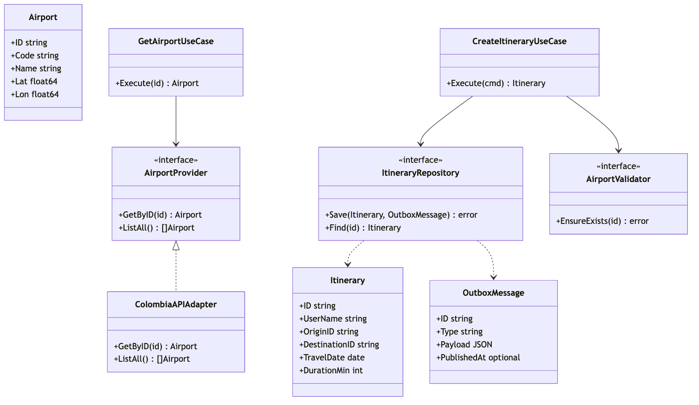
<p class="caption">Ilustración 5. Boceto de clases / puertos: use cases, repositorio, OutboxMessage, ColombiaAPIAdapter.</p>

#### SOLID (aplicación breve)

- **S:** un use case / adapter, una razón de cambio.  
- **O/D:** nuevos proveedores implementan el port sin modificar el dominio.  
- **I:** puertos segregados (`AirportProvider`, `AirportValidator`, `ItineraryRepository`).  
- **L:** adapters sustituibles en tests y en runtime.

### 10.2.3 Autenticación

Flujo demo académico: el frontend solicita token al Gateway; el perfil vive en `localStorage`; las mutaciones de itinerarios exigen Bearer.

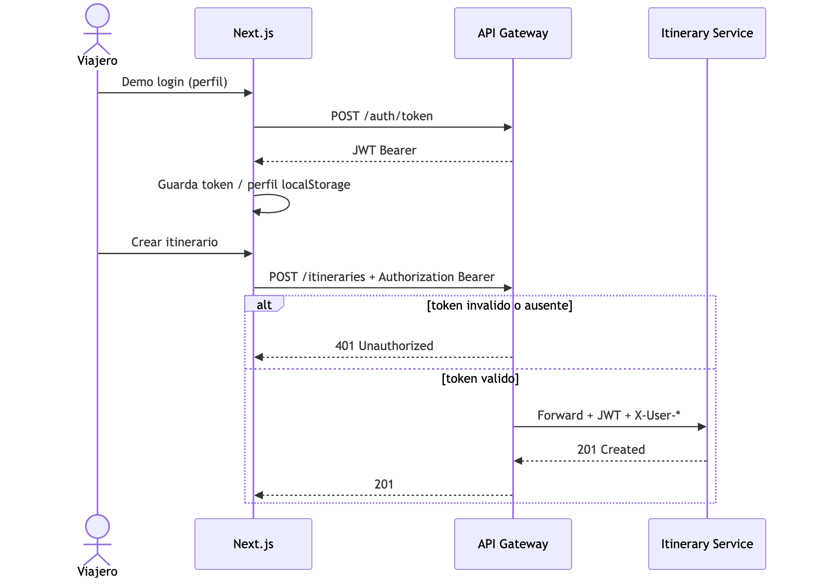
<p class="caption">Ilustración 6. Secuencia de autenticación JWT (demo login → token → rutas protegidas).</p>

#### Relaciones

| Nombre | Emisor | Receptor | Descripción |
|--------|--------|----------|-------------|
| Emit token | Web | Gateway | `POST /auth/token` |
| Validate & forward | Gateway | Itinerary | Valida JWT; reenvía `Authorization` + `X-User-*` |

### 10.2.4 Autorización

La autorización en este alcance académico se aplica en el **borde**: el Gateway rechaza itinerarios sin JWT válido. No hay Módulo Transversal de Seguridad externo; el diseño deja el borde listo para sustituir el emisor de tokens.

| Nombre | Emisor | Receptor | Descripción |
|--------|--------|----------|-------------|
| Enforce protected routes | Gateway | Cliente | 401 si falta/expira token en `/itineraries/*` |

### 10.2.5 Transacción Tipo A — Crear itinerario (+ notify async)

Transacción principal del sistema: validar aeropuertos, persistir itinerario y outbox en una TX, responder 201, y notificar de forma eventual.

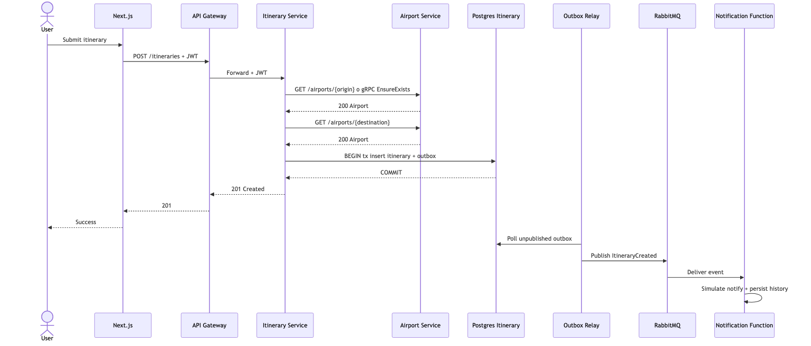
<p class="caption">Ilustración 7. Secuencia Transacción Tipo A — Create Itinerary + Outbox + Notification.</p>

#### Relaciones

| Nombre | Emisor | Receptor | Descripción |
|--------|--------|----------|-------------|
| Validate airports | Itinerary | Airport | Garantiza existencia origen/destino |
| Persist + outbox | Itinerary | Postgres | Misma transacción |
| Publish event | Relay | RabbitMQ | Marca `published_at` |
| Notify | RabbitMQ | Notification Function | Consumo idempotente |

### 10.2.6 Transacción Tipo B — Carga de mapa (aeropuertos)

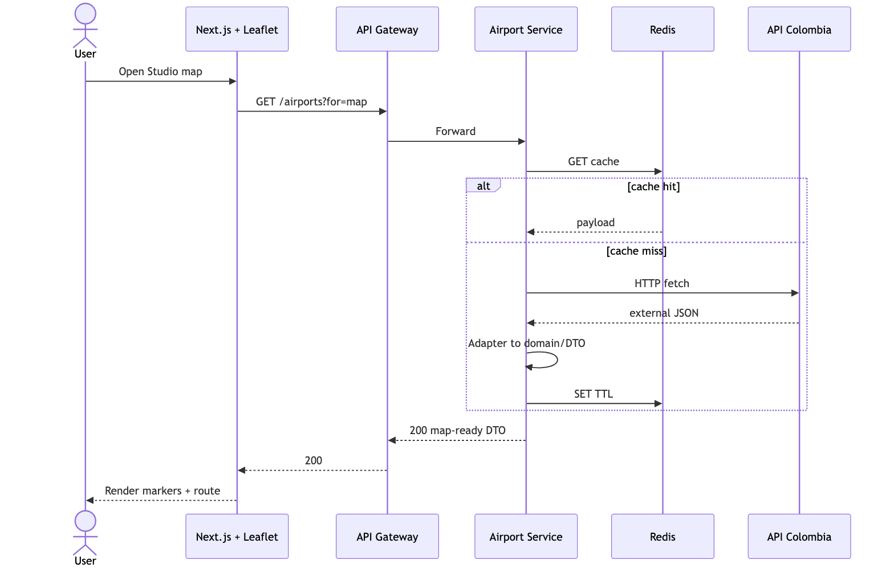
<p class="caption">Ilustración 8. Secuencia Transacción Tipo B — carga de aeropuertos para Studio (cache-aside).</p>

### 10.2.7 Transacción Tipo C — Resiliencia (circuit breaker)

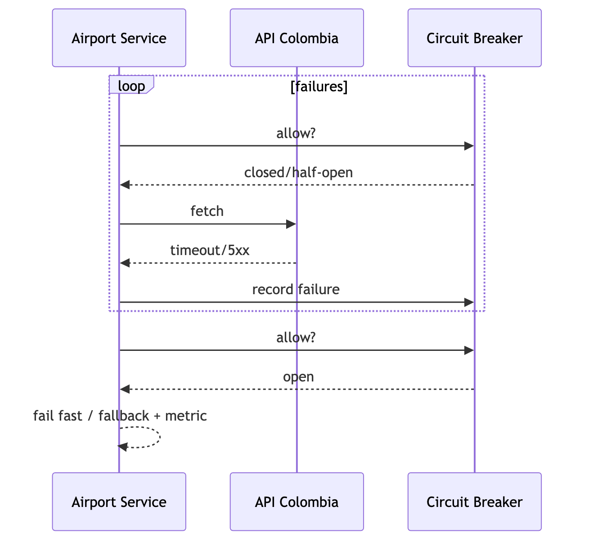
<p class="caption">Ilustración 9. Secuencia de apertura del Circuit Breaker ante fallos de API Colombia.</p>

### 10.2.8 Modelo de datos (lógico por servicio)

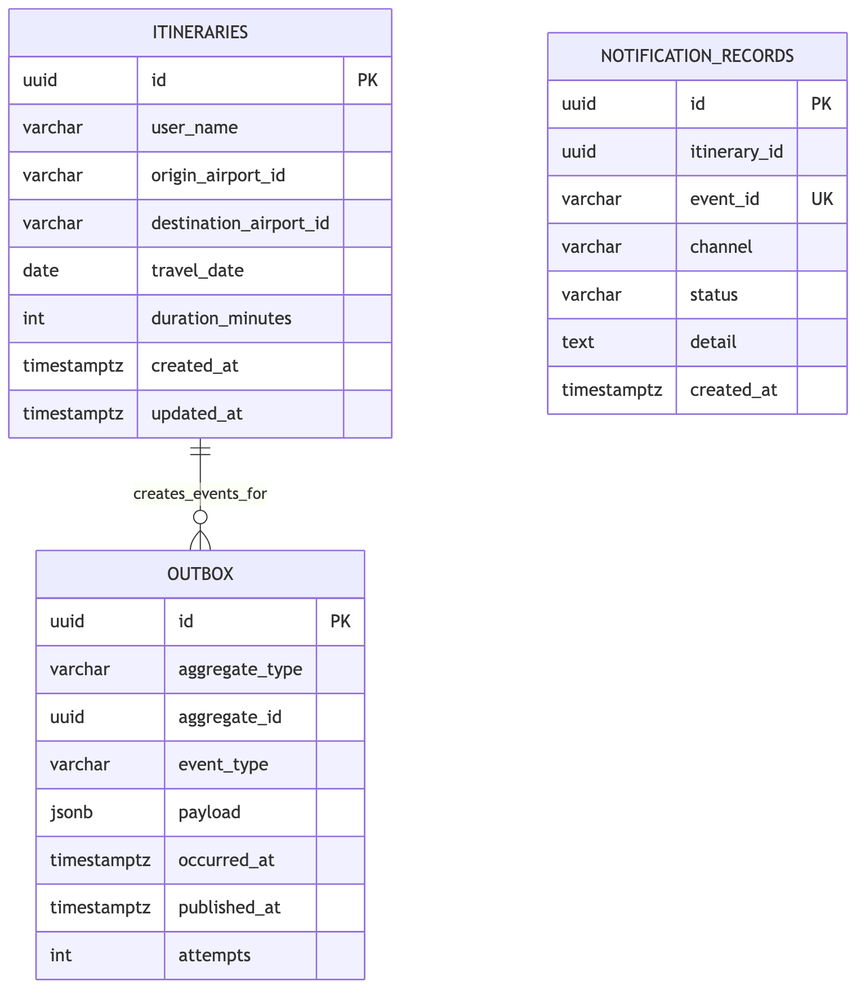
<p class="caption">Ilustración 10. Extracto ER: ITINERARIES + OUTBOX (+ NOTIFICATION_RECORDS en otra BD).</p>

---

## 10.3 Vista de integración

Ilustra interoperabilidades con sistemas internos y externos.

### 10.3.1 Interfaces con sistemas internos y externos

| Sistema | Protocolo | Táctica / patrón | Componentes | Observaciones |
|---------|-----------|------------------|-------------|---------------|
| API Colombia | HTTPS | Adapter / ACL | Airport Service (out/http) | Nunca llamado desde el browser |
| Next.js ↔ Gateway | HTTPS REST | BFF | Web, Gateway | OpenAPI; JWT en itinerarios |
| Gateway ↔ Services | HTTPS REST | Edge routing | Gateway, Airport, Itinerary | Sin lógica de negocio en Gateway |
| Itinerary ↔ Airport | REST / gRPC | Sync validation | Itinerary, Airport | gRPC + mTLS en L3 |
| Itinerary → Notification | AMQP | Outbox + eventos | Relay, RabbitMQ, FaaS | AsyncAPI `ItineraryCreated` |
| Observabilidad | OTLP | Tracing | Gateway/Airport/Itinerary → Jaeger | Correlación E2E |
| SonarCloud / GHCR | HTTPS | DevSecOps | GitHub Actions | Calidad + imágenes |

### 10.3.2 Diagrama de integración con API Colombia (equivalente “sistema externo”)


<p class="caption">Ilustración 11. Integración con API Colombia a través del Adapter (anti-corruption).</p>

**Manejo de excepciones / reintentos:** timeouts; retry exponencial con full jitter; circuit breaker; bulkhead de concurrencia; cache Redis; métricas cuando CB está open.

**Parámetros (conceptuales):** entrada = ID o listado para mapa; salida = DTO interno (`id`, `code`, `name`, `lat`, `lon`) apto para Leaflet.

### 10.3.3 Diagrama de integración asíncrona (notificación / “auditoría de eventos”)

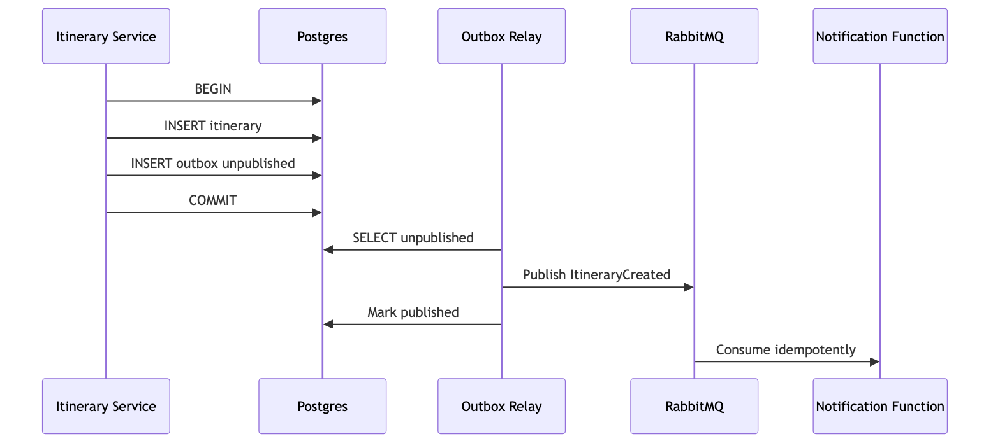
<p class="caption">Ilustración 12. Integración asíncrona confiable mediante Transactional Outbox (resuelve double-write).</p>

| Secuencia | Emisor | Receptor | Entrada / salida |
|-----------|--------|----------|------------------|
| 1 Commit | Itinerary Service | Postgres | Itinerary row + Outbox unpublished |
| 2 Publish | Outbox Relay | RabbitMQ | Payload AsyncAPI `ItineraryCreated` |
| 3 Consume | Notification Function | Postgres Notify | `NOTIFICATION_RECORDS` idempotente por `event_id` |

---

## 10.4 Vista de despliegue

Describe topología física/lógica de nodos y comunicación.

### 10.4.1 Consideraciones generales

Para el reto académico se proponen:

1. **Ambiente local / pruebas** — Docker Compose en el host del desarrollador (demo reproducible).  
2. **Ambiente de entrega / “producción académica”** — imágenes en GHCR + manifests Kubernetes con probes (sin exigir cluster vivo en Actions por defecto).

### 10.4.2 Ambiente de pruebas (local Compose)

| Equipo / servicio | Especificaciones orientativas | Cant. | Función |
|-------------------|-------------------------------|-------|---------|
| Host Docker | CPU ≥ 4 vCPU, RAM ≥ 8 GB | 1 | Orquestar stack completo |
| `web` | Node/Next container | 1 | UI RutaCO |
| `api-gateway` | Go, :8080 | 1 | Edge |
| `airport-service` | Go, :8081 | 1 | Catálogo + resiliencia |
| `itinerary-service` | Go, :8082 | 1 | CRUD + outbox |
| `notification-function` | Go consumer | 1 | FaaS simulado |
| Postgres ×3 | volúmenes locales | 3 | Una BD por servicio |
| Redis | :6379 | 1 | Cache |
| RabbitMQ | :5672 / UI :15672 | 1 | Broker |
| Jaeger / Prometheus / Grafana | Compose ops | 1 c/u | Observabilidad |
| Toxiproxy (opcional) | chaos latency | 1 | Demo resiliencia L3 |

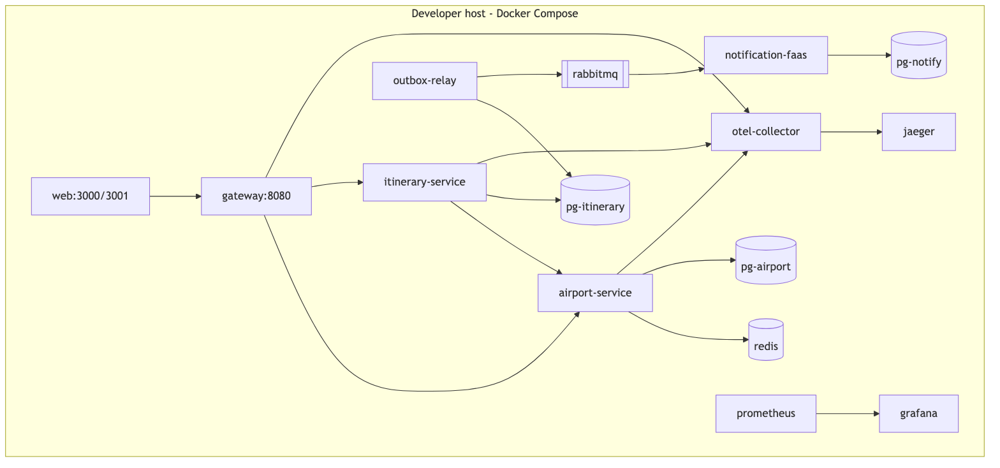
<p class="caption">Ilustración 13. Despliegue ambiente de pruebas / demo local (Docker Compose).</p>

**Objetivos del ambiente:** pruebas funcionales, demos de fallos controlados (`/api/v1/demo/fail`), evidencias de trazas/métricas, documentación de instalación (`make up` / `make smoke`).

### 10.4.3 Ambiente de producción (académico / K8s)

| Equipo / recurso | Especificaciones | Cant. | Función |
|------------------|------------------|-------|---------|
| Ingress | TLS terminado en edge | 1 | Entrada HTTP(S) |
| Deployment Gateway | probes `/ready` `/live` | ≥1 | BFF |
| Deployment Airport | probes + HPA opcional | ≥1 | Catálogo |
| Deployment Itinerary | probes + relay | ≥1 | CRUD + outbox |
| Job/Function Notify | trigger por cola | ≥1 | Notificaciones |
| Redis / RabbitMQ / Postgres | managed o pods | 1 c/u lógica | Datos y mensajería |
| GHCR | registry | 1 | Imágenes versionadas |

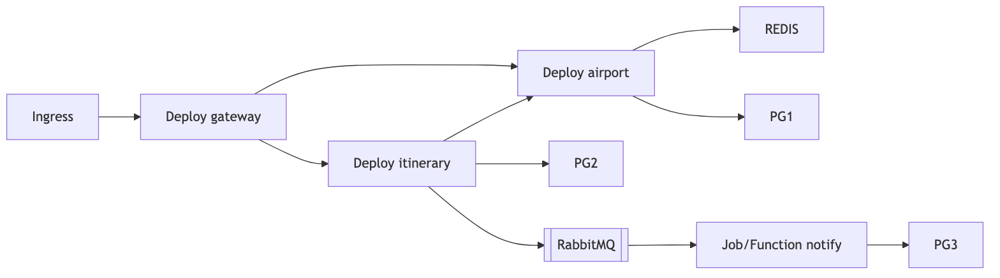
<p class="caption">Ilustración 14. Despliegue ambiente de producción académica (Kubernetes + probes).</p>

El ambiente debe soportar los RNF de disponibilidad, seguridad en tránsito y desplegabilidad definidos en la sección 5.

---

## 10.5 Procesos DevOps

Diseño alineado a DevSecOps: tests en PR, calidad SonarCloud, secretos fuera del repo, imágenes firmadas por pipeline.

### 10.5.1 Proceso de integración continua

| Workflow | Trigger | Propósito | Budget |
|----------|---------|-----------|--------|
| `ci.yml` | PR + push `main` | Unit tests Go (airport, itinerary, gateway, notify, proto) | `timeout-minutes: 3` |
| `sonar.yml` | PR + push `main` | Coverage + quality gate SonarCloud | ~15 min |
| `e2e-nightly.yml` | nightly / path / dispatch | E2E Testcontainers Postgres | ~10 min |

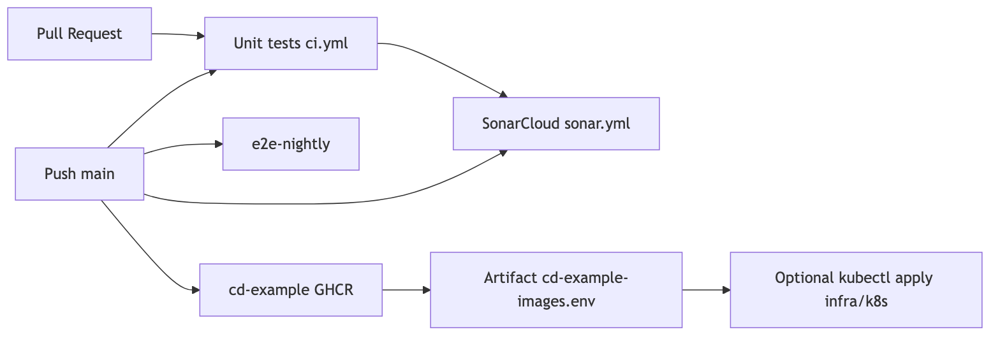
<p class="caption">Ilustración 15. Flujo CI/CD: PR → unit + Sonar; main → E2E + CD example GHCR.</p>

#### Relaciones (CI pruebas)

| Secuencia | Emisor | Receptor | Descripción |
|-----------|--------|----------|-------------|
| 1 | GitHub PR | `ci.yml` | Ejecuta unit tests |
| 2 | GitHub PR | `sonar.yml` | Análisis estático (`SONAR_TOKEN`) |
| 3 | Schedule / main | `e2e-nightly.yml` | Integración con Postgres real |

### 10.5.2 Proceso de despliegue continuo

**CD example (`cd-example.yml`):**

- Buildx de `airport-service`, `itinerary-service`, `api-gateway`, `notification-function`.  
- Push a `ghcr.io/<owner>/rutaco-<service>` (`latest`, semver, `sha-<short>`).  
- Artifact `infra/k8s/cd-example-images.env` para apply manual/staging.

**No hace (por diseño académico):** mutar un cluster de producción automáticamente sin kubeconfig.

#### Relaciones (CD)

| Secuencia | Emisor | Receptor | Descripción |
|-----------|--------|----------|-------------|
| 1 | Push `main` / tag `v*` | `cd-example.yml` | Build & push GHCR |
| 2 | Workflow | Artifact store | Publica pointer de imágenes |
| 3 | Operador | `kubectl apply infra/k8s` | Despliegue con probes |

**Git workflow obligatorio:** `main` actualizado → rama `feat|fix|docs|chore|...` → commit Conventional → PR → merge → publicar wiki si cambió `wiki/`.

---

## 10.6 Vista de amenazas

| Amenaza | Componentes involucrados | Estrategia de mitigación | RNFs impactados |
|---------|--------------------------|--------------------------|-----------------|
| Credenciales en repo | Todo el monorepo / CI | Secrets en GitHub Actions / env; nunca commit de `.env` | RNF-S4, RNF-P3 |
| Abuso de API / DoS básico | Gateway, servicios | Rate limit en Gateway | RNF-E3, RNF-S2 |
| Robo de datos en tránsito | Edge, S2S | HTTPS en deploy; mTLS gRPC | RNF-S3 |
| Eventos duplicados / redelivery | RabbitMQ, Notify | Consumidores idempotentes + `event_id` único | RNF-F2, RNF-S5 |
| Fuga de PII en logs | Todos los servicios | Redacción de campos sensibles; logs estructurados | RNF-S6 |
| Acoplamiento a API externa | Airport, Web | Adapter + DTOs internos; FE nunca llama Colombia | RNF-I1, RNF-M1 |
| Pérdida de eventos (double-write) | Itinerary, broker | Transactional Outbox + relay | RNF-F2 |
| Dependencia caída (API Colombia) | Airport | CB + retry + cache + métricas/alertas | RNF-F1, RNF-E1 |
| Imágenes / supply chain básica | CD | Builds en CI; registry GHCR; no tokens en git | RNF-D2, RNF-S4 |

---

# Referencias internas del monorepo

| Tema | Ruta |
|------|------|
| Visión y alcance | `docs/00-vision.md` |
| Overview | `docs/01-architecture/overview.md` |
| Documento formal (repo) | `docs/01-architecture/document.md` |
| Bounded contexts | `docs/01-architecture/bounded-contexts.md` |
| ADRs | `docs/01-architecture/adr/` |
| Diagramas Mermaid | `docs/03-diagrams/` |
| CI/CD | `docs/04-devops/ci-cd.md` |
| Branching | `docs/04-devops/branching.md` |
| Local setup / demo | `docs/05-runbooks/` |
| Autoevaluación L1–L3 | `docs/06-self-assessment.md` |
| Wiki publicada | https://github.com/bue221/proyecto-arquitectura-software-emergente/wiki |

---

# Anexos

## A. Stack decidido (resumen)

| Capa | Elección |
|------|----------|
| Frontend | Next.js 15 + TypeScript + Tailwind v4 + shadcn/ui + Framer Motion |
| Mapa | React-Leaflet + adapters de tiles |
| Backend | Go (hexagonal) |
| Gateway | Go BFF |
| DB | PostgreSQL (una por servicio) |
| Cache | Redis |
| Broker | RabbitMQ |
| Observabilidad | OpenTelemetry + Jaeger, Prometheus + Grafana |
| Orquestación | Docker Compose; Kubernetes (L3) |
| CI/CD | GitHub Actions + SonarCloud + GHCR |

## B. Evidencia de niveles (estado)

Según `docs/06-self-assessment.md`, los criterios de **Nivel 1, 2 y 3** están marcados como **done** (Adapter, hexagonal, Gateway+JWT, Redis+CB, Outbox, gRPC/mTLS, K8s probes, Pact, CI/CD, etc.). La evidencia operativa se obtiene con `make up`, `make smoke` y `make demo-evidence`.

---

*Fin del documento de arquitectura de software — RutaCO (Personal Itineraries Platform).*
