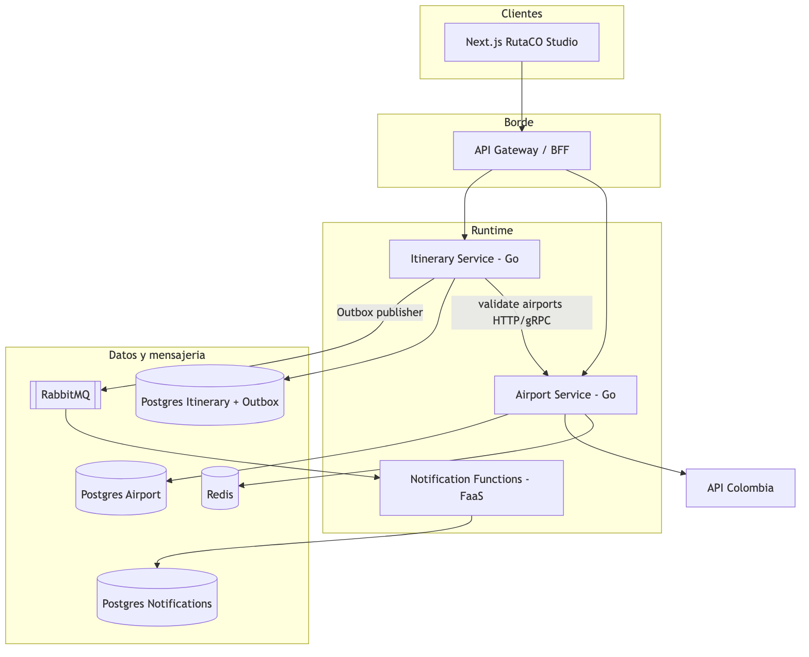
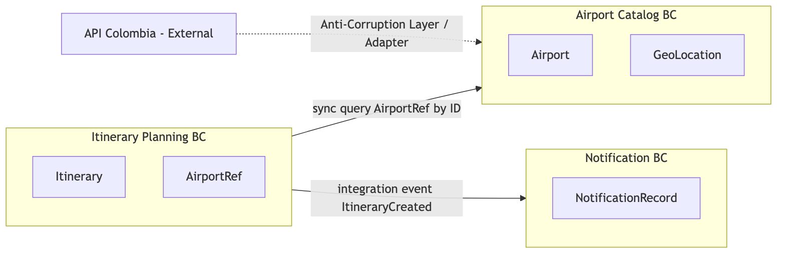
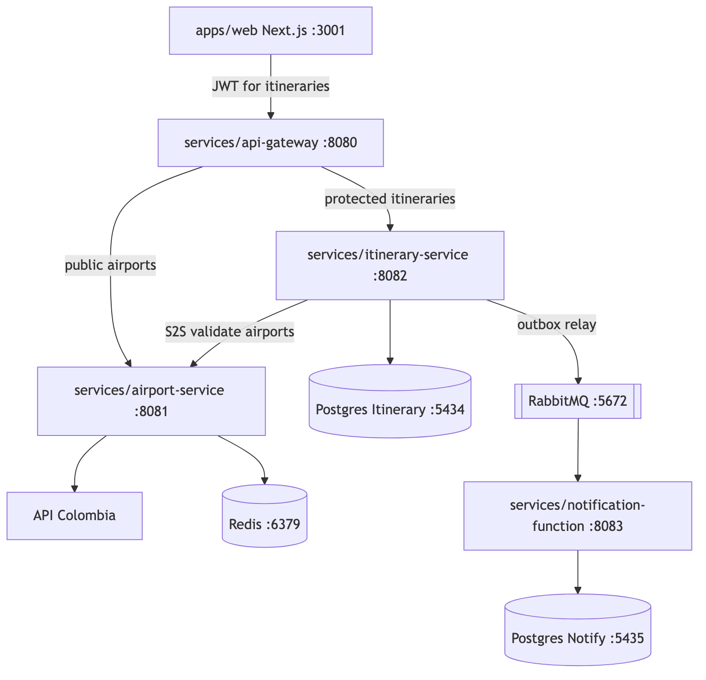
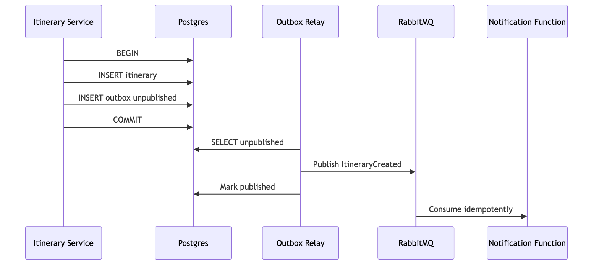
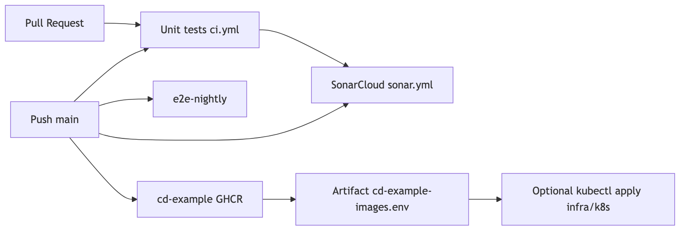

> **Fuente de verdad:** esta página se publica desde `wiki/` del monorepo.
> Edita vía Pull Request; no edites solo en la Wiki de GitHub sin sincronizar.

# Documento de arquitectura — PDF de entrega

Resumen en wiki del **documento formal de arquitectura de software** de **RutaCO** (Personal Itineraries Platform), alineado al formato académico (RNF, tácticas, vistas lógica / implementación / integración / despliegue / DevOps / amenazas).

| Campo | Valor |
|-------|--------|
| **Sistema** | RutaCO — Personal Itineraries Platform |
| **Versión** | 1.0.0 |
| **Fecha** | 2026-11-18 |
| **Autor** | Camilo Plaza |
| **Estado** | Niveles 1 + 2 + 3 implementados |

## Descargar el PDF

La wiki de GitHub **no incrusta PDFs**; el archivo vive versionado en el monorepo.

| Acción | Enlace |
|--------|--------|
| **Ver / descargar PDF** | [Documento-Arquitectura-RutaCO.pdf](https://github.com/bue221/proyecto-arquitectura-software-emergente/blob/main/docs/entregables/documento-arquitectura/Documento-Arquitectura-RutaCO.pdf) |
| Descarga directa (raw) | [raw PDF](https://raw.githubusercontent.com/bue221/proyecto-arquitectura-software-emergente/main/docs/entregables/documento-arquitectura/Documento-Arquitectura-RutaCO.pdf) |
| Fuente Markdown | [Documento-Arquitectura-RutaCO.md](https://github.com/bue221/proyecto-arquitectura-software-emergente/blob/main/docs/entregables/documento-arquitectura/Documento-Arquitectura-RutaCO.md) |
| Carpeta entregable | [`docs/entregables/documento-arquitectura/`](https://github.com/bue221/proyecto-arquitectura-software-emergente/tree/main/docs/entregables/documento-arquitectura) |
| Documento corto en wiki | [Architecture-document](Architecture-document) |

> Tip: en la página del blob de GitHub usa **Download** (botón de descarga) para guardar el PDF de entrega.

---

## Qué contiene el PDF (~32 páginas)

1. **Abreviaturas y definiciones** — JWT, Gateway/BFF, Outbox, FaaS, OTel, DDD, AsyncAPI, gRPC, ACL, RutaCO.  
2. **Introducción** — monorepo que combina microservicios + eventos + serverless.  
3. **Alcance** — aeropuertos CO vía Adapter, Studio Leaflet, CRUD itinerarios, Outbox, Gateway, K8s, CI/CD; fuera de alcance booking real / app nativa.  
4. **Interesados** — docente, desarrollador, QA, SRE, viajero.  
5. **RNF** — seguridad, interoperabilidad, fiabilidad, eficiencia, arquitectura, mantenibilidad, gestión de información, puesta en producción, DevOps.  
6. **Priorización** — (importancia, riesgo) con foco en hexagonal, CB/retry y Outbox.  
7. **Tácticas** — Ports & Adapters, cache-aside, Outbox, Gateway sin negocio, OTel, gRPC/mTLS.  
8. **Verificación** — escenarios y criterios de aceptación.  
9. **Lineamientos de componentes** — qué hace / qué no debe hacer cada servicio.  
10. **Vistas** — lógica (BCs), implementación (secuencias), integración (API Colombia + async), despliegue (Compose / K8s), DevOps (GitHub Actions), amenazas.

---

## Vista rápida (diagramas)

### Contexto de alto nivel

### Bounded contexts

### Componentes

### Outbox (publicación confiable)

### CI/CD

Más diagramas Mermaid versionados: [Diagrams-index](Diagrams-index).

---

## Stack (resumen)

| Capa | Elección |
|------|----------|
| Frontend | Next.js 15 + Leaflet + tile adapters (RutaCO) |
| Backend | Go hexagonal (`airport-service`, `itinerary-service`) |
| Edge | API Gateway Go (JWT + rate limit, sin negocio) |
| Datos | PostgreSQL una BD por servicio + Redis |
| Eventos | RabbitMQ + Transactional Outbox → FaaS notify |
| Ops | Compose local; K8s + probes; OTel/Jaeger; Prometheus |
| CI/CD | GitHub Actions + SonarCloud + GHCR |

Autoevaluación de rúbrica: [Self-assessment](Self-assessment).

---

## Cómo regenerar el PDF

Ver instrucciones en el README del entregable en el repo:

[`docs/entregables/documento-arquitectura/README.md`](https://github.com/bue221/proyecto-arquitectura-software-emergente/blob/main/docs/entregables/documento-arquitectura/README.md)
