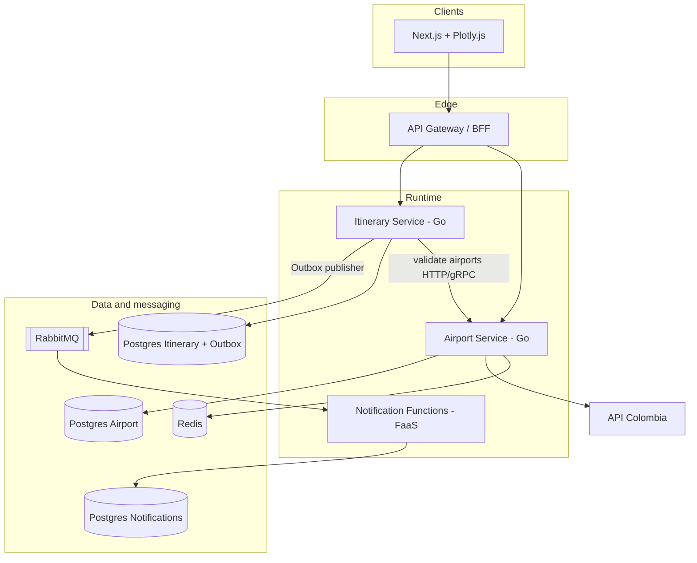

> **Fuente de verdad:** esta página se publica desde `wiki/` / `docs/` del monorepo.
> Edita vía Pull Request en el código; no edites solo en la Wiki sin sincronizar.

# Architecture overview

## Intent

Combine three styles in one runnable system:

| Style | Where | How we prove it |
|-------|-------|-----------------|
| Microservices | `airport-service`, `itinerary-service` | Separate deployables, DBs, HTTP/gRPC |
| Event-driven | Itinerary → broker → FaaS | Outbox + AsyncAPI + consumers |
| Serverless | `notification-function` | Ephemeral handlers on events / on-demand reports |

Cross-cutting: **hexagonal architecture**, **DDD bounded contexts**, **Adapter** for API Colombia, **Gateway** without business logic.

## High-level view



## Service responsibilities

### Airport Service

- Port: `AirportProvider` (domain).
- Adapter: API Colombia HTTP client → domain model → Plotly-friendly DTO.
- Resilience: timeout, retry+backoff+jitter, circuit breaker, Redis cache.
- Exposes REST (and later gRPC) for airport by ID / list for map.

### Itinerary Service

- Aggregate: `Itinerary` (user name, origin ID, destination ID, travel date, duration minutes).
- CRUD on own Postgres.
- Before persist: verify airports exist via Airport Service.
- On create: write row + outbox row in **one transaction**; relay publishes `ItineraryCreated`.

### Notification Function (Serverless)

- Triggered by broker event (not a long-lived business API).
- Simulates notification delivery; stores history in its DB.
- Optional on-demand report function for metrics consolidation.

### API Gateway

- Routes `/airports/*`, `/itineraries/*`.
- Rate limiting, JWT validation/propagation.
- **No** itinerary or airport business rules.

## Hexagonal slice (every Go service)

```text
cmd/                 # main, wiring
internal/domain/     # entities, ports, domain errors
internal/application/# use cases
internal/adapters/in/http|grpc/
internal/adapters/out/postgres|redis|http|messaging/
```

Dependency rule: adapters depend inward; domain depends on nothing external.

## Quality attributes (prioritized)

| Priority | Attribute | Tactic |
|----------|-----------|--------|
| H | Modularity / maintainability | Hexagonal + BC isolation |
| H | Reliability | Timeouts, CB, outbox, retries |
| H | Observability | OTel traces, JSON logs, Prometheus |
| M | Performance | Redis cache, Go concurrency model |
| M | Security | JWT at edge, S2S propagation; mTLS/OAuth later (L3) |
| M | Deployability | Compose → GH Actions → K8s |

## Integration styles

| From → To | Style | Contract |
|-----------|-------|----------|
| Web → Gateway | HTTPS REST | OpenAPI |
| Gateway → Services | HTTPS REST | OpenAPI |
| Itinerary → Airport | REST (L1/L2), gRPC (L3) | OpenAPI / Protobuf |
| Itinerary → Notifications | Async events | AsyncAPI |
| Airport → API Colombia | HTTPS + Adapter | External schema mapped internally |

## Double Write Problem (Level 3)

Publishing to RabbitMQ in a second step after `INSERT itinerary` can lose events or create orphans.

**Resolution:** Transactional Outbox — same DB transaction writes itinerary + outbox message; a publisher/CDC worker emits to the broker; consumers are idempotent.

Details: [`../03-diagrams/outbox.md`](../03-diagrams/outbox.md) and ADR-0005.

## Next reading

- Formal doc: [`document.md`](document.md)
- DDD: [`bounded-contexts.md`](bounded-contexts.md)
- Diagrams: [`../03-diagrams/`](../03-diagrams/)
