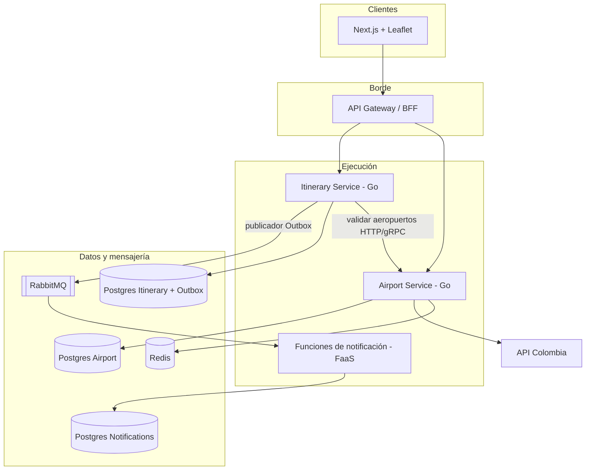

> **Fuente de verdad:** esta página se publica desde `wiki/` / `docs/` del monorepo.
> Edita vía Pull Request en el código; no edites solo en la Wiki sin sincronizar.

# Resumen de arquitectura

## Intención

Combinar tres estilos en un sistema que se puede ejecutar:

| Estilo | Dónde | Cómo se demuestra |
|--------|-------|-------------------|
| Microservicios | `airport-service`, `itinerary-service` | Despliegues, bases y HTTP/gRPC separados |
| Orientado a eventos | Itinerary → bróker → FaaS | Outbox + AsyncAPI + consumidores |
| Serverless | `notification-function` | Handlers efímeros ante eventos o reportes bajo demanda |

Transversal: **arquitectura hexagonal**, **contextos delimitados (DDD)**, **Adapter** para API Colombia y **Gateway** sin lógica de negocio.

## Vista de alto nivel



## Responsabilidades por servicio

### Airport Service

- Puerto: `AirportProvider` (dominio).
- Adapter: cliente HTTP de API Colombia → modelo de dominio → DTO apto para el mapa.
- Resiliencia: timeout, retry + backoff + jitter, circuit breaker, caché Redis.
- Expone REST (y luego gRPC) para aeropuerto por ID y listado del mapa.

### Itinerary Service

- Agregado: `Itinerary` (nombre de usuario, ID de origen, ID de destino, fecha de viaje, duración en minutos).
- CRUD sobre su propio Postgres.
- Antes de persistir: verifica que los aeropuertos existan vía Airport Service.
- Al crear: escribe la fila y la fila de outbox en **una transacción**; el relay publica `ItineraryCreated`.

### Notification Function (serverless)

- Se dispara por un evento del bróker (no es una API de negocio de larga vida).
- Simula el envío de la notificación y guarda el historial en su BD.
- Función opcional de reporte bajo demanda para consolidar métricas.

### API Gateway

- Enruta `/airports/*` y `/itineraries/*`.
- Rate limiting y validación/propagación de JWT.
- **Sin** reglas de negocio de itinerarios ni de aeropuertos.

## Corte hexagonal (cada servicio Go)

```text
cmd/                 # main, cableado
internal/domain/     # entidades, puertos, errores de dominio
internal/application/# casos de uso
internal/adapters/in/http|grpc/
internal/adapters/out/postgres|redis|http|messaging/
```

Regla de dependencias: los adaptadores apuntan hacia adentro; el dominio no depende de nada externo.

## Atributos de calidad (priorizados)

| Prioridad | Atributo | Táctica |
|-----------|----------|---------|
| A | Modularidad / mantenibilidad | Hexagonal + aislamiento de BC |
| A | Confiabilidad | Timeouts, CB, outbox, reintentos |
| A | Observabilidad | Trazas OTel, logs JSON, Prometheus |
| M | Rendimiento | Caché Redis, modelo de concurrencia de Go |
| M | Seguridad | JWT en el borde, propagación S2S; mTLS/OAuth después (N3) |
| M | Desplegabilidad | Compose → GitHub Actions → K8s |

## Estilos de integración

| De → A | Estilo | Contrato |
|--------|--------|----------|
| Web → Gateway | HTTPS REST | OpenAPI |
| Gateway → servicios | HTTPS REST | OpenAPI |
| Itinerary → Airport | REST (N1/N2), gRPC (N3) | OpenAPI / Protobuf |
| Itinerary → Notifications | Eventos async | AsyncAPI |
| Airport → API Colombia | HTTPS + Adapter | Esquema externo mapeado adentro |

## Problema de double write (Nivel 3)

Publicar en RabbitMQ en un segundo paso, después del `INSERT` del itinerario, puede perder eventos o dejar huérfanos.

**Resolución:** Transactional Outbox. La misma transacción de BD escribe el itinerario y el mensaje de outbox; un worker publicador/CDC lo emite al bróker; los consumidores son idempotentes.

Detalle: [Diagrams-outbox](Diagrams-outbox) y ADR-0005.

## Lectura siguiente

- Documento formal: [Architecture-document](Architecture-document)
- DDD: [Bounded-contexts](Bounded-contexts)
- Diagramas: [Diagrams-index](Diagrams-index)
