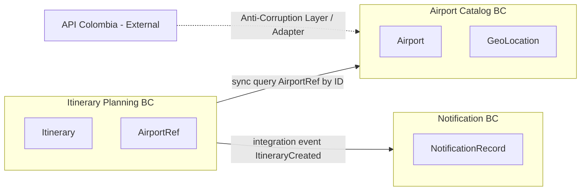

> **Fuente de verdad:** esta página se publica desde `wiki/` / `docs/` del monorepo.
> Edita vía Pull Request en el código; no edites solo en la Wiki sin sincronizar.

# Bounded contexts & ubiquitous language (DDD)

## Context map

## Contexts

### 1. Airport Catalog

**Purpose:** Provide a trusted, internal representation of Colombian airports for maps and validation.

**Ubiquitous language**

| Term | Meaning |
|------|---------|
| Airport | Domain entity with stable internal ID, code, name, coordinates |
| AirportProvider | Port to obtain airports from the outside world |
| CatalogCache | Short-lived cached catalog snapshot |
| PlotlyPoint | Read-model coordinates/name for the map UI |

**Aggregate decision — Airport**

We treat **Airport as a referenced value/identity from the itinerary’s point of view**, not as a full nested aggregate copied into every itinerary.

- Itinerary stores **AirportRef** (ID + optional denormalized label for display).
- Canonical airport data lives in Airport Catalog BC.
- Avoids dual ownership and stale full copies (Level 1 sync validation; Level 2/3 may keep a local read-optimized copy explicitly documented).

### 2. Itinerary Planning

**Purpose:** Let a user create and manage personal trip itineraries between two airports.

**Ubiquitous language**

| Term | Meaning |
|------|---------|
| Itinerary | Aggregate root: user name, origin, destination, travel date, duration minutes |
| AirportRef | Identity reference to an airport in Catalog BC |
| ItineraryCreated | Integration event after successful create |
| OutboxMessage | Durable pending integration event |

**Invariants**

- Origin and destination airport IDs must exist in Catalog at write time.
- Duration minutes > 0.
- Travel date required.

### 3. Notification

**Purpose:** React to itinerary lifecycle integration events; record delivery/history.

**Ubiquitous language**

| Term | Meaning |
|------|---------|
| NotificationRecord | Persisted attempt/result of a notification |
| ItineraryCreated (consumer) | Trigger payload; no ownership of itinerary aggregate |

## Domain events vs integration events

| Kind | Where | Example | Audience |
|------|-------|---------|----------|
| Domain event | Inside a BC, optional | `ItineraryValidated` | Same process / same BC |
| Integration event | Across BCs via broker | `ItineraryCreated` | Notification FaaS, future consumers |

Only **integration events** are documented in AsyncAPI and published through the outbox.

## Anti-corruption layer

API Colombia schemas never leak into Itinerary BC or the Next.js app. Translation happens only in Airport Service adapters.
