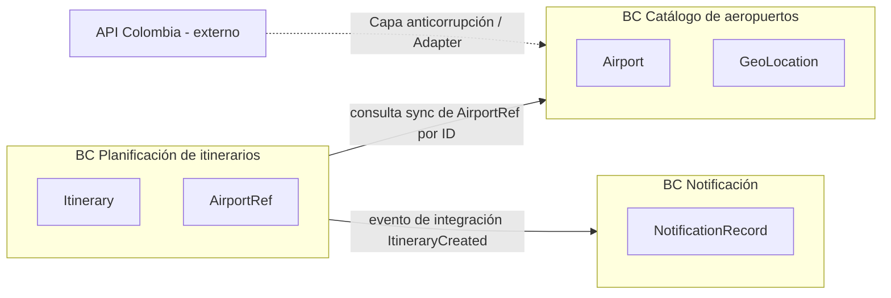

> **Fuente de verdad:** esta página se publica desde `wiki/` / `docs/` del monorepo.
> Edita vía Pull Request en el código; no edites solo en la Wiki sin sincronizar.

# Contextos delimitados y lenguaje ubicuo (DDD)

## Mapa de contextos

## Contextos

### 1. Catálogo de aeropuertos

**Propósito:** ofrecer una representación interna y confiable de los aeropuertos colombianos para el mapa y la validación.

**Lenguaje ubicuo**

| Término | Significado |
|---------|-------------|
| Airport | Entidad de dominio con ID interno estable, código, nombre y coordenadas |
| AirportProvider | Puerto para obtener aeropuertos del mundo exterior |
| CatalogCache | Instantánea de corta vida del catálogo en caché |
| PlotlyPoint | Modelo de lectura (coordenadas y nombre) para la UI del mapa |

**Decisión de agregado — Airport**

Desde el itinerario, **Airport es una identidad/valor referenciado**, no un agregado completo copiado dentro de cada itinerario.

- El itinerario guarda **AirportRef** (ID + etiqueta desnormalizada opcional para mostrar).
- Los datos canónicos viven en el BC Catálogo de aeropuertos.
- Se evita la doble propiedad y las copias completas vencidas (validación síncrona en Nivel 1; en Nivel 2/3 puede existir una copia local de lectura, documentada de forma explícita).

### 2. Planificación de itinerarios

**Propósito:** permitir que una persona cree y gestione itinerarios personales entre dos aeropuertos.

**Lenguaje ubicuo**

| Término | Significado |
|---------|-------------|
| Itinerary | Raíz de agregado: nombre, origen, destino, fecha de viaje, duración en minutos |
| AirportRef | Referencia de identidad a un aeropuerto del BC Catálogo |
| ItineraryCreated | Evento de integración tras una creación exitosa |
| OutboxMessage | Evento de integración pendiente y durable |

**Invariantes**

- Los IDs de aeropuerto de origen y destino deben existir en el catálogo al momento de escribir.
- La duración en minutos es mayor que 0.
- La fecha de viaje es obligatoria.

### 3. Notificación

**Propósito:** reaccionar a eventos de integración del ciclo de vida del itinerario y registrar entrega e historial.

**Lenguaje ubicuo**

| Término | Significado |
|---------|-------------|
| NotificationRecord | Intento o resultado persistido de una notificación |
| ItineraryCreated (consumidor) | Payload disparador; no es dueño del agregado itinerario |

## Eventos de dominio frente a eventos de integración

| Tipo | Dónde | Ejemplo | Audiencia |
|------|-------|---------|-----------|
| Evento de dominio | Dentro de un BC, opcional | `ItineraryValidated` | El mismo proceso / el mismo BC |
| Evento de integración | Entre BCs, vía bróker | `ItineraryCreated` | FaaS de notificación y consumidores futuros |

Solo los **eventos de integración** se documentan en AsyncAPI y se publican por el outbox.

## Capa anticorrupción

Los esquemas de API Colombia no se filtran al BC de itinerarios ni a la app Next.js. La traducción ocurre solo en los adaptadores de Airport Service.
