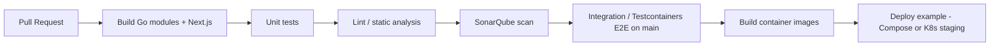

> **Fuente de verdad:** esta página se publica desde `wiki/` / `docs/` del monorepo.
> Edita vía Pull Request en el código; no edites solo en la Wiki sin sincronizar.

# CI/CD plan

## Why

Level 3 and the DevOps rubric require continuous integration and an example of continuous deployment, plus quality gates (tests, SonarQube).

## Target pipeline (GitHub Actions)

## Jobs (planned under `.github/workflows/`)

| Workflow | Trigger | Purpose |
|----------|---------|---------|
| `ci.yml` | PR + push `main` | Build, unit test, lint |
| `sonar.yml` | PR + main | SonarQube / SonarCloud |
| `e2e.yml` | main / nightly | Testcontainers flow |
| `cd-example.yml` | tags / main | Push images + sample deploy |

Exact YAML arrives in `chore/ci-*` PRs after services exist.

## Environments

| Env | Purpose |
|-----|---------|
| Local Compose | Dev + demo |
| CI ephemeral | PR verification |
| Staging K8s (optional) | CD example with probes |

## Secrets

Stored in GitHub Actions secrets — never in git. Document required names in the workflow PR.
