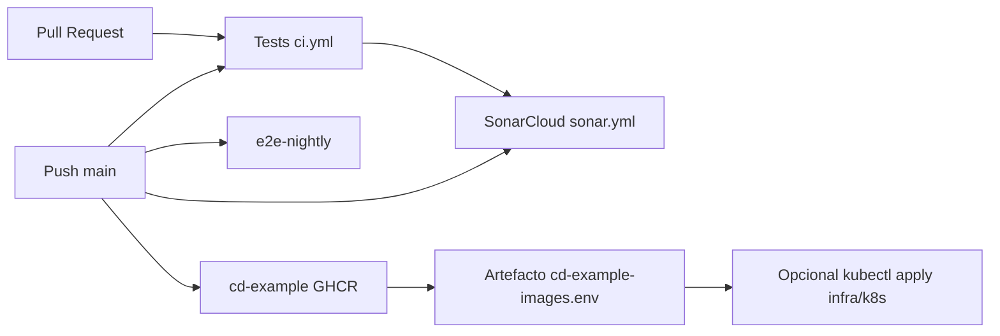

# Plan de CI/CD

## Por qué

El Nivel 3 y la rúbrica de DevOps piden integración continua, un ejemplo de entrega continua y compuertas de calidad (tests, SonarCloud).

## Actual

| Workflow | Disparador | Propósito | Presupuesto |
|----------|------------|-----------|-------------|
| [`ci.yml`](https://github.com/bue221/proyecto-arquitectura-software-emergente/blob/main/.github/workflows/ci.yml) | PR + push a `main` | Tests unitarios Go | `timeout-minutes: 3` |
| [`e2e-nightly.yml`](https://github.com/bue221/proyecto-arquitectura-software-emergente/blob/main/.github/workflows/e2e-nightly.yml) | nightly / rutas en `main` | E2E Testcontainers | 10 min |
| [`sonar.yml`](https://github.com/bue221/proyecto-arquitectura-software-emergente/blob/main/.github/workflows/sonar.yml) | PR + `main` | Cobertura + **SonarCloud** | 15 min |
| [`cd-example.yml`](https://github.com/bue221/proyecto-arquitectura-software-emergente/blob/main/.github/workflows/cd-example.yml) | `main` / tags `v*` | Build y push a **GHCR** + artefacto de tags | ~20 min |

## CD mínimo

**Hace:** publica imágenes `ghcr.io/<owner>/rutaco-<servicio>` y deja un artefacto con tags `sha-…` para aplicar `infra/k8s/` en local/staging.

**No hace:** exigir un cluster Kubernetes vivo dentro de Actions (sin kubeconfig por defecto).

## SonarCloud (una vez)

1. Crear el proyecto en [sonarcloud.io](https://sonarcloud.io) ligado a este repo.
2. Añadir el secret de Actions **`SONAR_TOKEN`**.
3. Verificar `sonar.projectKey` y `sonar.organization` en `sonar-project.properties`.
4. Reejecutar el workflow `sonar`.

## Secretos

| Nombre | Workflow | Notas |
|--------|----------|-------|
| `SONAR_TOKEN` | `sonar.yml` | Obligatorio para el escaneo |
| `GITHUB_TOKEN` | `cd-example.yml` | Incluido; el workflow pide `packages: write` |
