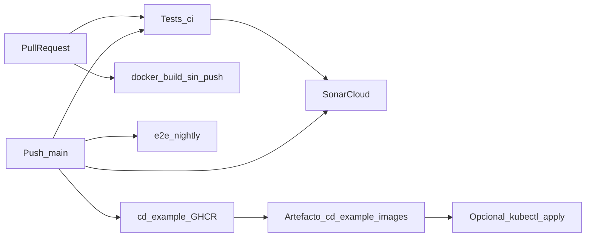

# Plan de CI/CD

## Por qué

El Nivel 3 y la rúbrica de DevOps piden integración continua, un ejemplo de entrega continua y compuertas de calidad (tests, SonarCloud).

## Actual

| Workflow | Disparador | Propósito | Presupuesto |
|----------|------------|-----------|-------------|
| [`ci.yml`](https://github.com/bue221/proyecto-arquitectura-software-emergente/blob/main/.github/workflows/ci.yml) | PR + push a `main` | Tests Go + Vitest (`web-tests`) + **build Docker** (sin push) | tests ≤3 min; docker ≤12 min |
| [`e2e-nightly.yml`](https://github.com/bue221/proyecto-arquitectura-software-emergente/blob/main/.github/workflows/e2e-nightly.yml) | nightly / rutas en `main` | E2E Testcontainers | 10 min |
| [`sonar.yml`](https://github.com/bue221/proyecto-arquitectura-software-emergente/blob/main/.github/workflows/sonar.yml) | PR + `main` | Cobertura + **SonarCloud** (omite el scan si falta `SONAR_TOKEN`) | 15 min |
| [`cd-example.yml`](https://github.com/bue221/proyecto-arquitectura-software-emergente/blob/main/.github/workflows/cd-example.yml) | `main` / tags `v*` | Build y push a **GHCR** (Go + **web**) + artefacto de tags | ≤12 min |

## CD mínimo

**Hace:** publica imágenes `ghcr.io/<owner>/rutaco-<servicio>` (incluye `rutaco-web`) y deja un artefacto con tags `sha-…` (`WEB_IMAGE` incluido) para aplicar `infra/k8s/` en local/staging. Usa caché BuildKit de GitHub Actions por servicio.

**No hace:** exigir un cluster Kubernetes vivo dentro de Actions (sin kubeconfig por defecto).

## Velocidad de Docker

Los Dockerfiles:

- Copian `go.mod` / `go.sum` (y `packages/proto` cuando aplica) antes del código fuente
- Usan cache mounts de BuildKit para módulos Go / npm
- Publican Next.js con `output: "standalone"` (imagen web sin `node_modules` completo)

En local, deja BuildKit activo (`DOCKER_BUILDKIT=1`; por defecto en Docker Desktop reciente).

## SonarCloud (una vez)

1. Crear el proyecto en [sonarcloud.io](https://sonarcloud.io) ligado a este repo.
2. Añadir el secret de Actions **`SONAR_TOKEN`**.
3. Verificar `sonar.projectKey` y `sonar.organization` en `sonar-project.properties`.
4. Reejecutar el workflow `sonar`.

Si `SONAR_TOKEN` no está configurado, la cobertura Go igual corre y el paso de scan se omite con un aviso (el PR no queda rojo).

## Secretos

| Nombre | Workflow | Notas |
|--------|----------|-------|
| `SONAR_TOKEN` | `sonar.yml` | Necesario para el escaneo; opcional para CI verde |
| `GITHUB_TOKEN` | `cd-example.yml` | Incluido; el workflow pide `packages: write` |
