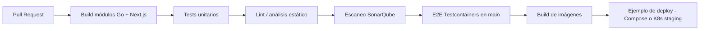

# Plan de CI/CD

## Por qué

El Nivel 3 y la rúbrica de DevOps piden integración continua, un ejemplo de despliegue continuo y compuertas de calidad (tests, SonarQube).

## Actual (este estado)

| Workflow | Disparador | Propósito | Presupuesto |
|----------|------------|-----------|-------------|
| [`.github/workflows/ci.yml`](https://github.com/bue221/proyecto-arquitectura-software-emergente/blob/main/.github/workflows/ci.yml) | PR + push a `main` | **Solo tests unitarios Go** (airport, itinerary, gateway, notify, proto) | `timeout-minutes: 3` |

Todavía no hay publicación de imágenes, Sonar ni Deploy: el CI se mantiene rápido hasta que eso llegue en PRs dedicados.

## Pipeline objetivo (después)

## Jobs (planeados)

| Workflow | Disparador | Propósito |
|----------|------------|-----------|
| `ci.yml` | PR + push a `main` | Tests unitarios (hecho) |
| `sonar.yml` | PR + main | SonarQube / SonarCloud |
| `e2e.yml` | main / nightly | Flujo Testcontainers |
| `cd-example.yml` | tags / main | Push de imágenes + deploy de muestra |

## Entornos

| Entorno | Propósito |
|---------|-----------|
| Compose local | Desarrollo + demo |
| CI efímero | Verificación del PR |
| K8s staging (opcional) | Ejemplo de CD con probes |

## Secretos

Viven en los secrets de GitHub Actions — nunca en git. Documentar los nombres requeridos cuando exista CD.
