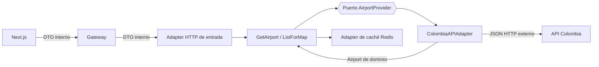

> **Fuente de verdad:** esta página se publica desde `wiki/` / `docs/` del monorepo.
> Edita vía Pull Request en el código; no edites solo en la Wiki sin sincronizar.

# Patrón Adapter (Airport Service)

## Reglas

1. El **puerto** (`AirportProvider`) se define en el lenguaje del dominio.
2. El **Adapter** traduce campos externos → `Airport` (capa anticorrupción).
3. Los controladores exponen DTOs **internos** (incluidas coordenadas aptas para el mapa).
4. El frontend **nunca** importa ni llama URLs de API Colombia.

## Por qué

Cumple el requisito formal de Adapter de la rúbrica y deja la volatilidad externa fuera del BC de itinerarios y de la UI.
