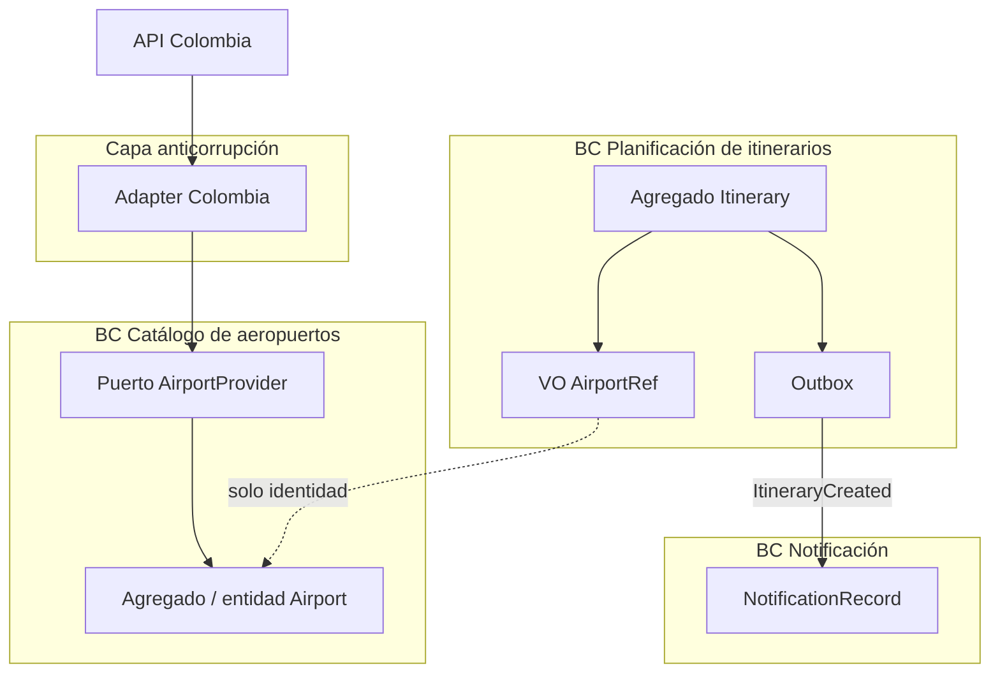

> **Fuente de verdad:** esta página se publica desde `wiki/` / `docs/` del monorepo.
> Edita vía Pull Request en el código; no edites solo en la Wiki sin sincronizar.

# Diagrama de contextos delimitados

La narración está en [Bounded-contexts](Bounded-contexts).

