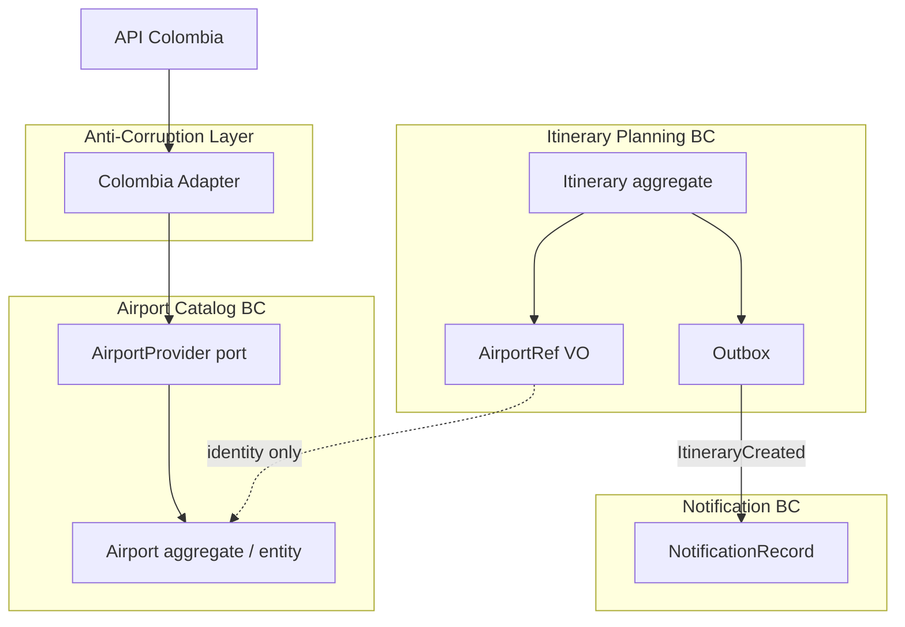

> **Fuente de verdad:** esta página se publica desde `wiki/` / `docs/` del monorepo.
> Edita vía Pull Request en el código; no edites solo en la Wiki sin sincronizar.

# Bounded contexts diagram

See also the narrative in [`../01-architecture/bounded-contexts.md`](../01-architecture/bounded-contexts.md).

