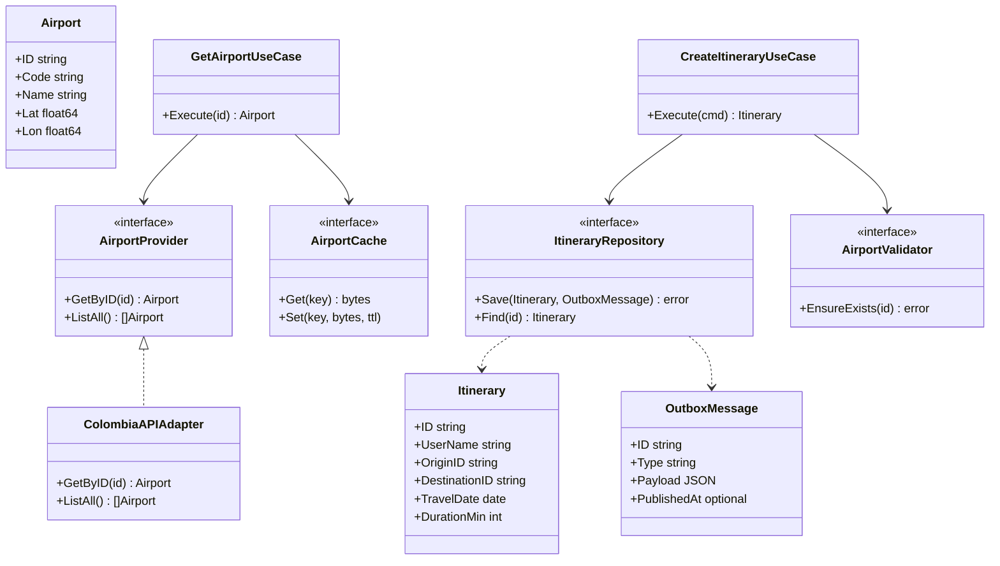

> **Fuente de verdad:** esta página se publica desde `wiki/` / `docs/` del monorepo.
> Edita vía Pull Request en el código; no edites solo en la Wiki sin sincronizar.

# Esquema de clases / hexagonal

Vista conceptual (los nombres coinciden con el código).

## Mapeo SOLID (corto)

- **S:** cada caso de uso y cada adapter tiene una sola razón para cambiar.
- **O:** un proveedor nuevo implementa `AirportProvider` sin editar el código de itinerarios.
- **L:** los adapters honran el contrato del puerto (incluida la semántica de errores).
- **I:** puertos estrechos (`AirportValidator` no es la API de administración del catálogo).
- **D:** la aplicación depende de puertos, no de tipos concretos de HTTP o de BD.
