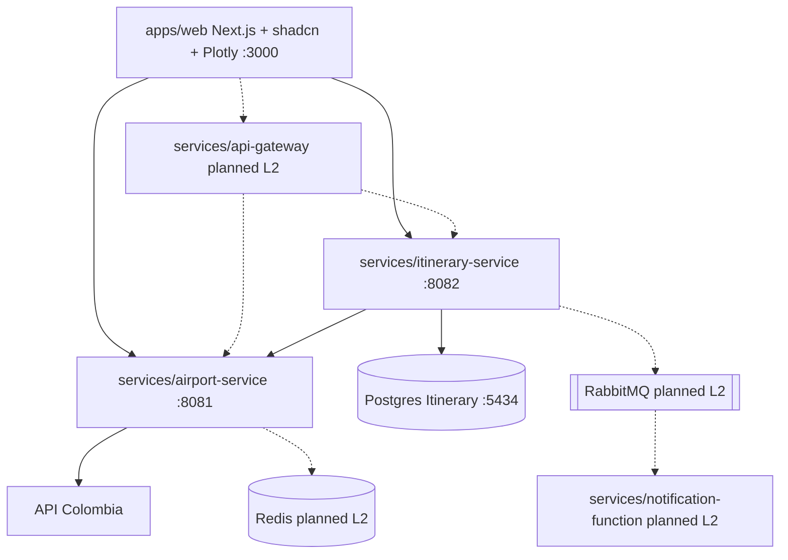

> **Fuente de verdad:** esta página se publica desde `wiki/` / `docs/` del monorepo.
> Edita vía Pull Request en el código; no edites solo en la Wiki sin sincronizar.

# Component diagram

## Current Level 1 wiring

- Web calls Airport and Itinerary **directly** (Gateway arrives in Level 2).
- Airport uses in-memory cache today; Redis is Level 2.
- Itinerary writes outbox rows; broker relay is Level 2/3.

## Notes

- Each service package is independently buildable/deployable.
- Contracts live in `packages/contracts` and `packages/proto` (not shown as runtime boxes).
