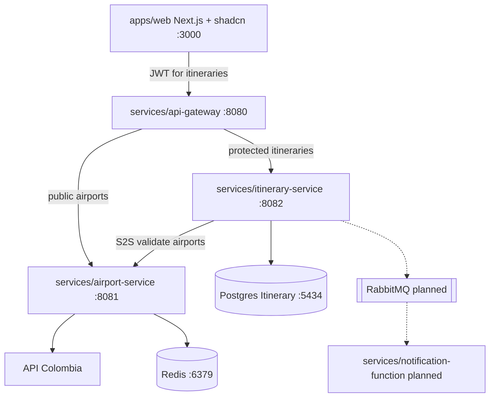

> **Fuente de verdad:** esta página se publica desde `wiki/` / `docs/` del monorepo.
> Edita vía Pull Request en el código; no edites solo en la Wiki sin sincronizar.

# Component diagram

## Current wiring

- Browser → **API Gateway only** (`:8080`).
- Airport → Redis cache-aside + circuit breaker on Colombia HTTP.
- Itinerary writes outbox rows; broker relay is still planned.
- Local: `make up` from repo root.

## Notes

- Each service package is independently buildable/deployable.
- Contracts live in `packages/contracts` and `packages/proto` (not shown as runtime boxes).
