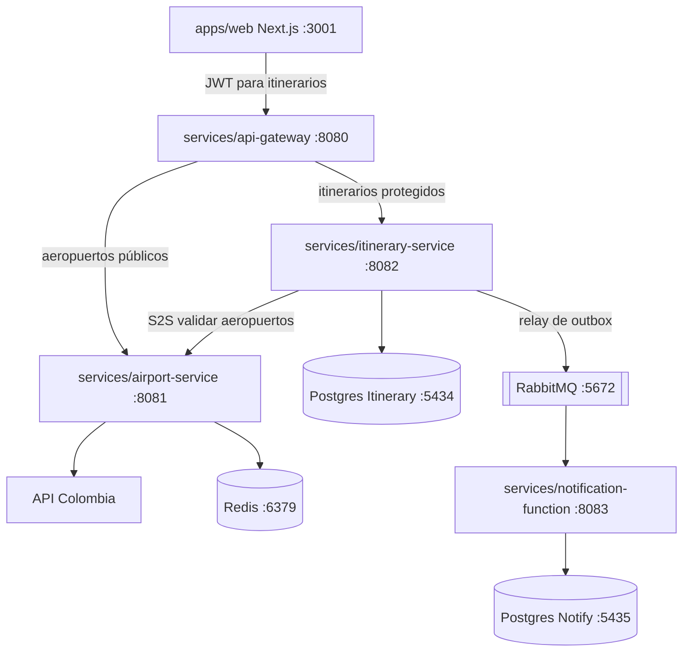

# Diagrama de componentes

## Cableado actual

- El navegador va **solo al API Gateway** (`:8080`).
- Las rutas de itinerario exigen un JWT Bearer emitido por `POST /auth/token`.
- Itinerary → Airport sigue siendo servicio a servicio directo (no pasa por el gateway).
- Airport → caché Redis cache-aside; el circuit breaker envuelve el HTTP de Colombia.
- Relay de outbox de Itinerary → RabbitMQ → notification-function (idempotente).

## Notas

- Cada paquete de servicio se construye y despliega por separado.
- Los contratos viven en `packages/contracts` y `packages/proto`.
- Stack local: `make up` desde la raíz del repo.
