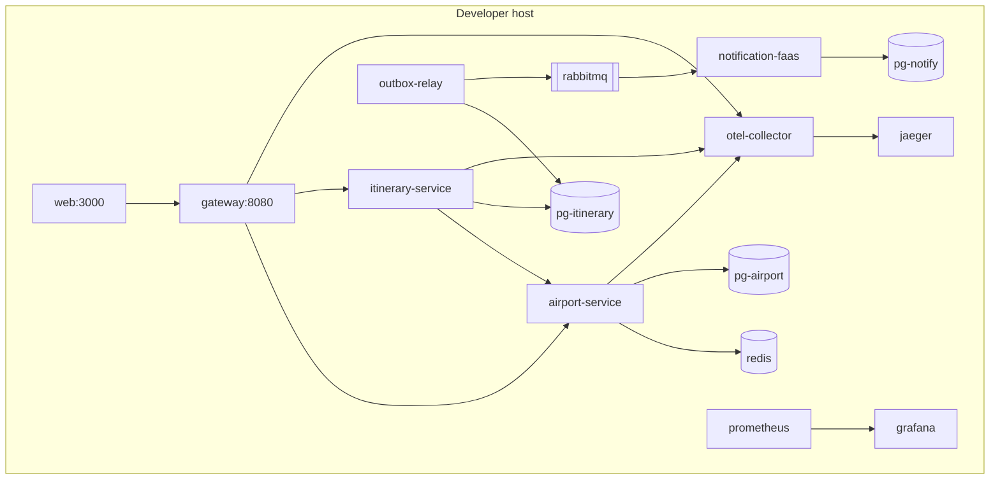
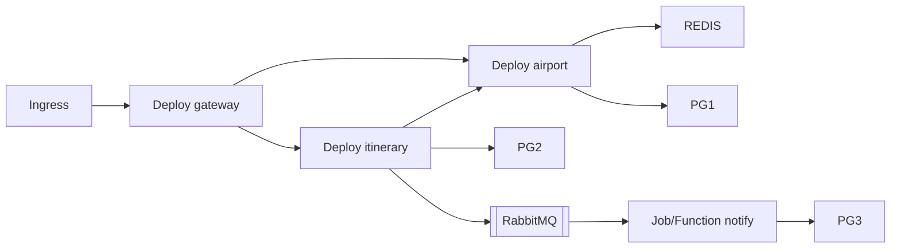

> **Fuente de verdad:** esta página se publica desde `wiki/` / `docs/` del monorepo.
> Edita vía Pull Request en el código; no edites solo en la Wiki sin sincronizar.

# Deployment views

## Local (Docker Compose) — target

Compose files will live under `infra/docker/` in implementation PRs.

## Kubernetes (Level 3 — target)

Each Deployment exposes **readiness** and **liveness** probes. Details in `infra/k8s/` when implemented.
