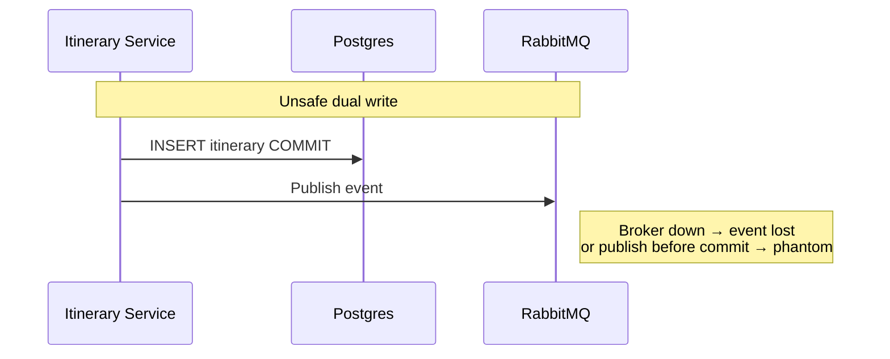
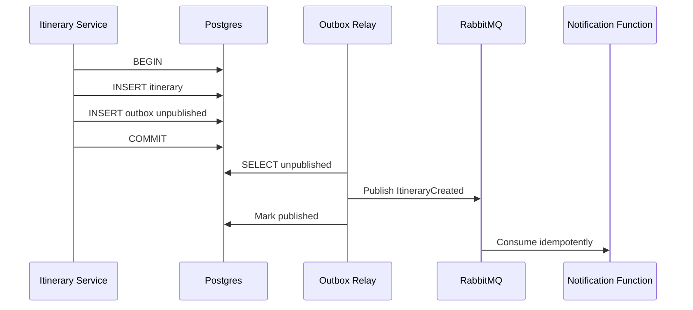

> **Fuente de verdad:** esta página se publica desde `wiki/` / `docs/` del monorepo.
> Edita vía Pull Request en el código; no edites solo en la Wiki sin sincronizar.

# Transactional Outbox & Double Write

## Problem

## Solution

## Guarantees

- **No event without committed itinerary** (same transaction).
- **At-least-once** to consumers → idempotent handlers.
- Relay lag is acceptable (eventual consistency) and must be metricized.
