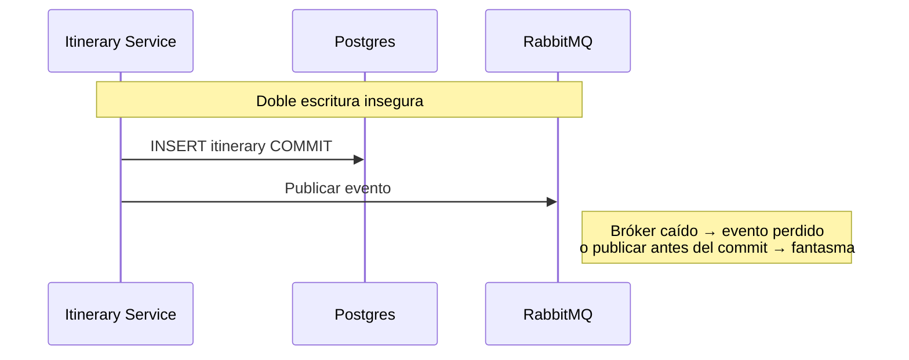
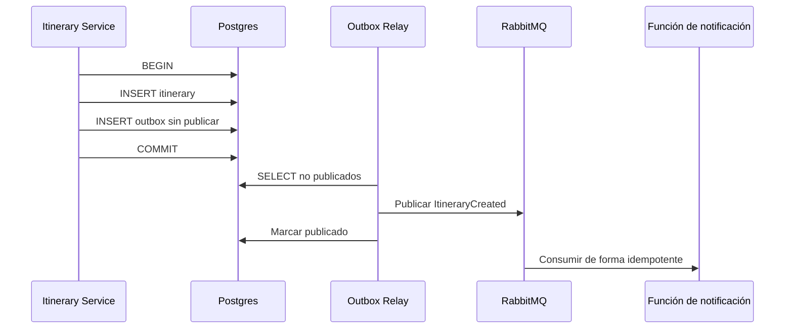

> **Fuente de verdad:** esta página se publica desde `wiki/` / `docs/` del monorepo.
> Edita vía Pull Request en el código; no edites solo en la Wiki sin sincronizar.

# Transactional Outbox y double write

## Problema

## Solución

## Garantías

- **No hay evento sin itinerario confirmado** (la misma transacción).
- **At-least-once** hacia los consumidores → handlers idempotentes.
- El retraso del relay es aceptable (consistencia eventual) y debe medirse.
