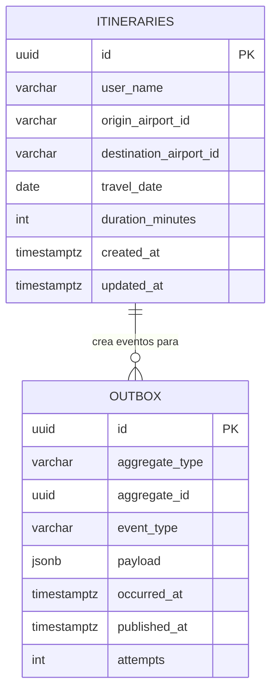
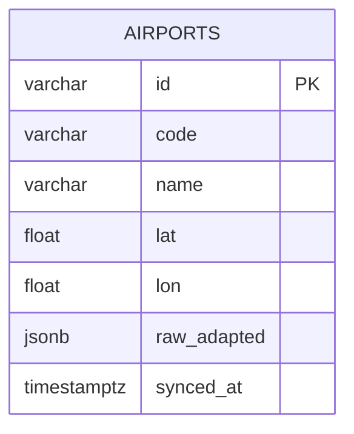
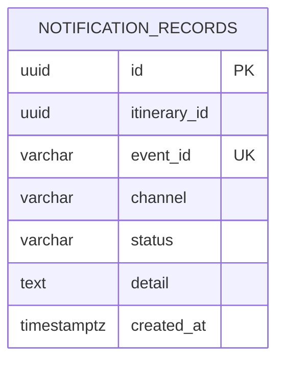

> **Fuente de verdad:** esta página se publica desde `wiki/` / `docs/` del monorepo.
> Edita vía Pull Request en el código; no edites solo en la Wiki sin sincronizar.

# Modelo relacional (por servicio)

Las bases **no se comparten**. Los diagramas de abajo son esquemas lógicos de cada servicio.

## BD de Itinerary Service

## BD de Airport Service (persistencia o espejo opcional)

El Nivel 1 puede apoyarse en Redis + el adapter en vivo, sin una tabla completa de aeropuertos. Si se introduce, las migraciones se versionan solo dentro de este servicio.

## BD de notificaciones

