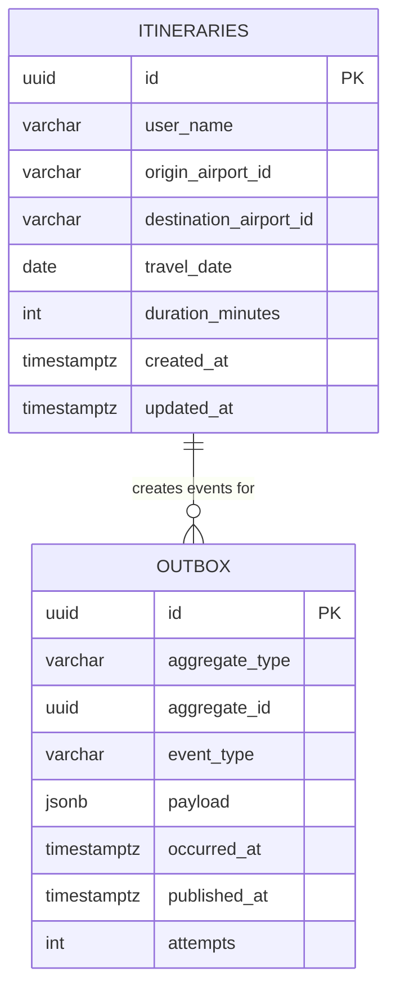
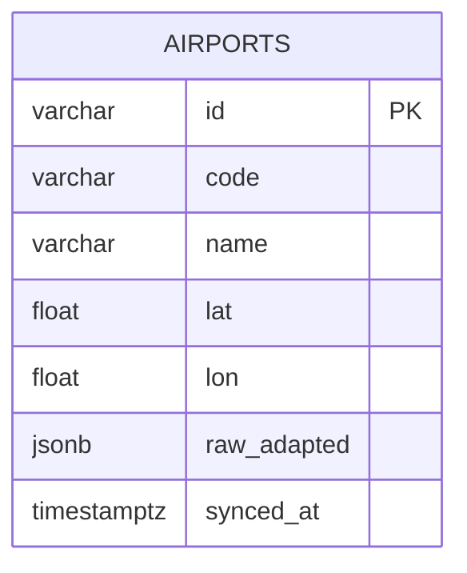
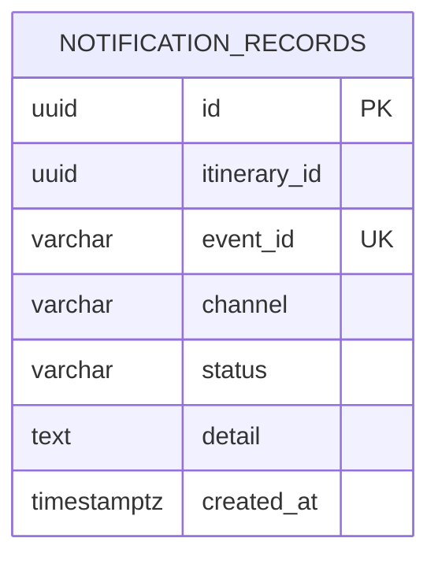

> **Fuente de verdad:** esta página se publica desde `wiki/` / `docs/` del monorepo.
> Edita vía Pull Request en el código; no edites solo en la Wiki sin sincronizar.

# Relational model (per service)

Databases are **not shared**. Diagrams below are logical schemas per service.

## Itinerary Service DB

## Airport Service DB (optional persistence / mirror)

Level 1 may rely on Redis + live adapter without a full airport table; if introduced, migrations are versioned inside this service only.

## Notification DB

