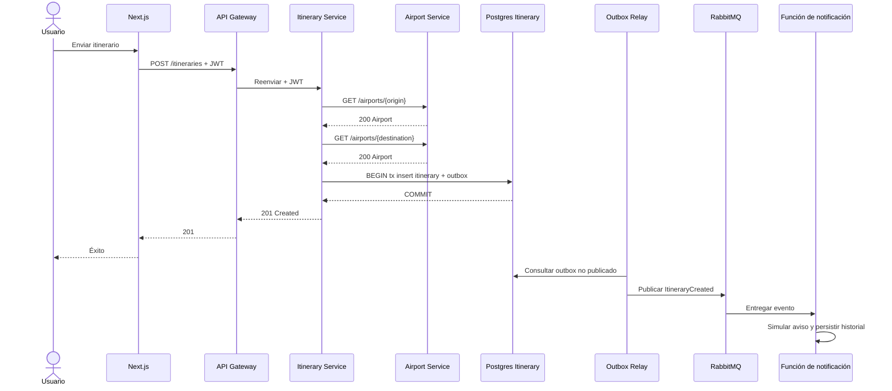
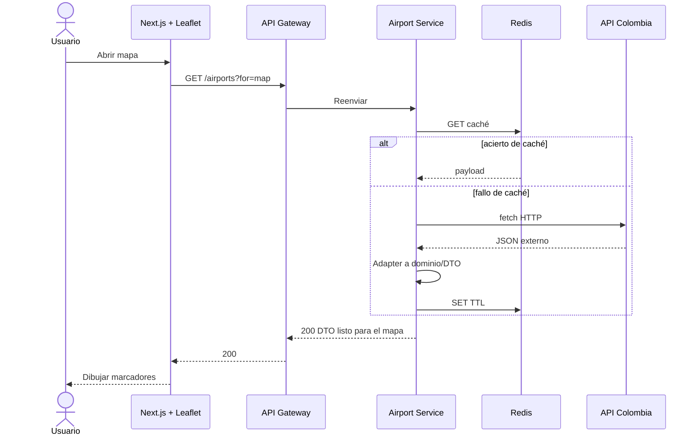
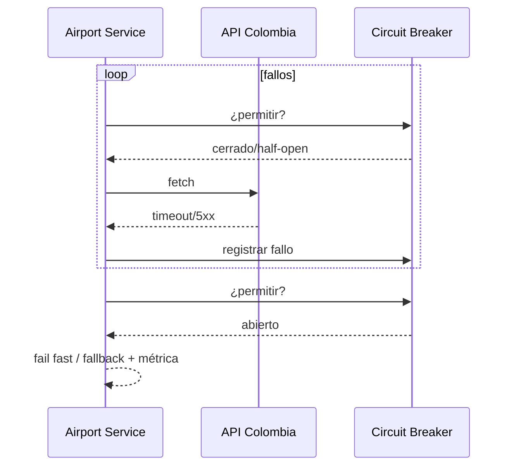

> **Fuente de verdad:** esta página se publica desde `wiki/` / `docs/` del monorepo.
> Edita vía Pull Request en el código; no edites solo en la Wiki sin sincronizar.

# Diagramas de secuencia

## Crear itinerario (camino síncrono + notificación async)

## Carga del mapa (aeropuertos)

## Demo de resiliencia (circuit breaker)

